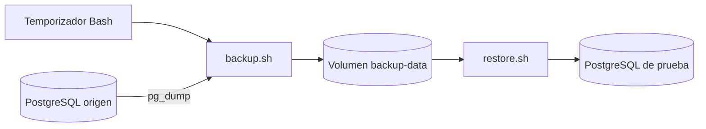

# HU-07 - Backups automatizados de PostgreSQL

El Compose principal inicia los backups junto con el PostgreSQL de HU-04. La restauración se verificó en un entorno aislado con los datos sintéticos de HU-06.

## 1. Qué resuelve y cómo funciona

Un backup lógico es una exportación de la estructura y de los datos de una base. `pg_dump` obtiene una vista consistente de esa base mientras permite el uso normal de lecturas y escrituras. No copia físicamente el volumen de PostgreSQL. Tampoco incluye los roles globales del clúster.

El contenedor de backups ejecuta herramientas cliente; no inicia un servidor de base de datos. Se conecta al servidor por una red Docker interna, sin publicar puertos y sin acceder al socket Docker.



Se eligió formato personalizado `--format=custom` y compresión interna `--compress=gzip:6`. El archivo termina en `.dump`, no en `.sql.gz`: contiene un archivo PostgreSQL comprimido internamente, no SQL plano comprimido. Se recupera con `pg_restore`. Esto concilia la compresión gzip solicitada en el contexto con la restauración mediante pg_restore.

Referencia oficial: https://www.postgresql.org/docs/16/app-pgdump.html

## 2. Archivos y responsabilidades

| Archivo en db-scripts/backups                 | Responsabilidad                                                    |
| --------------------------------------------- | ------------------------------------------------------------------ |
| backup.sh                                     | Exportación, reintentos, bloqueo, checksum y retención             |
| scheduler.sh                                  | Copia inicial y ejecución periódica                                |
| restore.sh                                    | Verifica checksum y restaura en una base temporal nueva            |
| tests/compose.hu04.yml                        | Aísla el PostgreSQL de HU-04 y agrega un servidor de restauración  |
| tests/restore.hu04.sh y tests/verify.hu04.sql | Restauran y comparan datos sintéticos del esquema de la aplicación |

## 3. Decisiones explicadas

- `set -Eeuo pipefail`: detiene el script ante fallos y variables ausentes. Los fallos esperados se manejan explícitamente.
- `umask 077`: los archivos nuevos quedan privados para su usuario.
- `flock`: impide dos exportaciones simultáneas en el mismo volumen. El sistema libera el bloqueo al terminar el proceso.
- Tres intentos: tolera fallos transitorios con una espera de dos segundos. Tras tres fallos devuelve error.
- Archivo `.partial`: durante la exportación no se presenta como respaldo terminado. Se elimina si falla; se renombra después de validar tamaño y tabla de contenidos.
- SHA-256: permite detectar si el archivo cambió accidentalmente. No demuestra por sí solo que pueda recuperarse y no protege contra un atacante que también cambie el manifiesto.
- Retención: borra solo archivos propios `backup_*.dump` de más de siete días y sus manifiestos, después de producir una copia correcta. No elimina las copias antiguas si falla el backup nuevo.
- Temporizador: ejecuta una copia al arrancar y espera 86400 segundos después de cada ejecución. No significa "a las 03:00" ni recupera ejecuciones perdidas durante apagados. Al reiniciar realiza una nueva copia.
- `restore.sh`: exige un nombre `hu07_restore_...`, crea una base nueva y falla si ya existe. No contiene DROP DATABASE ni --clean. La restauración se ejecuta en una transacción; si falla se conserva la base creada para inspección.
- `--no-owner --no-privileges`: en la prueba los objetos se asignan al usuario de restauración. Los roles y permisos de producción deberán provisionarse por separado.

## 4. Evidencia del laboratorio inicial

Pruebas realizadas el 6 de noviembre de 2026 (Argentina); las marcas UTC pasan al 7 de noviembre. Imagen utilizada: postgres:16-bookworm.

| Comprobación                         | Resultado observado                                                                        |
| ------------------------------------ | ------------------------------------------------------------------------------------------ |
| Ejecución periódica sin intervención | SUCCESS a 00:00:14, 00:00:24 y 00:00:34 UTC                                                |
| Respaldo de laboratorio              | 7656 bytes; ejecución de la prueba sin reintentos menor a un segundo según contador entero |
| Base temporal recuperada             | hu07_restore_test_1794009647                                                               |
| Datos                                | 100 jugadores, 1000 eventos, suma 500500                                                   |
| Firma del contenido de eventos       | 0146f55449cd2342edf487832f042f7a; igual en origen y destino                                |
| Estructura                           | 5 restricciones e índice eventos_jugador_idx                                               |
| Secuencia                            | Nuevo evento recibió id 1001                                                               |
| Base existente                       | Rechazada sin sobrescribir                                                                 |
| Host inexistente                     | Tres intentos, salida de error, sin dump final ni parcial residual                         |
| Copia alterada                       | Rechazada por checksum                                                                     |
| Retención                            | Copia sintética de diez días y su manifiesto eliminados después de copia exitosa           |
| Concurrencia                         | Segunda ejecución rechazada mientras otro proceso tenía el bloqueo                         |
| Persistencia                         | Copia previa accesible desde un contenedor nuevo conectado al mismo volumen                |

Estos resultados corresponden al laboratorio inicial, cuyos archivos se retiraron al consolidar la prueba integrada.

## 5. Uso habitual desde la raíz

Usar el `.env` de la raíz, configurado a partir de `.env.example`. La plantilla se versiona como referencia y el `.env` local guarda los valores de cada equipo. Los backups reutilizan `POSTGRES_DB`, `POSTGRES_USER` y `POSTGRES_PASSWORD` y se conectan al servicio `postgres` por el puerto 5432 de `db-network`.

El servicio de backups espera el estado saludable de `postgres`. El servicio auxiliar `backup-permissions` prepara el volumen y termina. El proceso que hace los backups corre con el usuario `postgres`. Los valores de frecuencia y retención se pueden ajustar en el mismo `.env` raíz.

```powershell
docker compose up -d
docker compose logs --tail 20 backups
```

La integración reutiliza la cuenta configurada por HU-04. Para producción, un usuario dedicado debe tener `CONNECT` y permisos suficientes de lectura sobre los objetos actuales y futuros. Coordinar también las extensiones, los permisos de restauración y la versión mayor del cliente. La HU requiere revisión e integración por PR según la definición de hecho del equipo.

## 6. Prueba con HU-04 y el dataset de HU-06

La prueba lee el mismo `.env` raíz y recibe la contraseña del destino de prueba por una variable temporal de PowerShell. El Compose de prueba quita el nombre fijo y el puerto publicado de PostgreSQL y agrega el destino `restore`. Cada ejecución usa un nombre de proyecto nuevo para obtener volúmenes y red propios.

Los scripts de HU-06 contienen `DROP` y `TRUNCATE`. Ejecutarlos únicamente sobre una base de prueba nueva y vacía, después de comprobar que corresponde al proyecto aislado. Desde la raíz, en PowerShell:

```powershell
$proyectoHU07 = 'hu07-check-' + (Get-Date -Format 'yyyyMMddHHmmss')
$env:HU07_RESTORE_PASSWORD = [guid]::NewGuid().ToString('N')
$env:BACKUP_INTERVAL_SECONDS = '10'
$dc = @('compose','-p',$proyectoHU07,'-f','docker-compose.yml',
        '-f','db-scripts/backups/tests/compose.hu04.yml')
docker @dc up -d --wait postgres restore
if ($LASTEXITCODE -ne 0) { throw 'Falló el arranque de PostgreSQL' }
$origen = docker @dc ps -q postgres
$volumen = docker inspect --format '{{range .Mounts}}{{println .Name .Destination}}{{end}}' $origen
if ($volumen -notcontains "${proyectoHU07}_pgdata /var/lib/postgresql/data") { throw 'El volumen no pertenece a la prueba' }
docker @dc cp db-scripts/init/01_schema_init.sql postgres:/tmp/hu07-schema.sql
docker @dc cp db-scripts/seeders/02_massive_seed_6M.sql postgres:/tmp/hu07-seed.sql
docker @dc exec -T postgres sh -c 'psql -X -v ON_ERROR_STOP=1 -U "$POSTGRES_USER" -d "$POSTGRES_DB" -f /tmp/hu07-schema.sql -f /tmp/hu07-seed.sql'
if ($LASTEXITCODE -ne 0) { throw 'Falló la carga sintética' }
docker @dc up -d backups
docker @dc logs --tail 20 backups
```

Esperar un `SUCCESS` posterior a la carga. Tomar el nombre del `.dump` que figura en el registro. Mantener el origen sin escrituras durante la comparación de la prueba. El temporizador de diez segundos sirve para observar la periodicidad y se puede detener cuando haya generado dos copias:

```powershell
docker @dc stop backups
$dump = '/backups/<nombre-del-dump>'
$env:RESTORE_TEST_PASSWORD = $env:HU07_RESTORE_PASSWORD
docker @dc run --rm --no-deps -e RESTORE_TEST_PASSWORD --entrypoint bash backups /scripts/tests/restore.hu04.sh $dump
$testExit = $LASTEXITCODE
docker @dc stop
Remove-Item Env:RESTORE_TEST_PASSWORD, Env:HU07_RESTORE_PASSWORD, Env:BACKUP_INTERVAL_SECONDS
if ($testExit -ne 0) { throw 'Falló la prueba integrada' }
```

### Resultado de la prueba integrada del 8 de noviembre de 2026

El temporizador generó dos copias automáticas de **134.473.355 bytes**. Las ejecuciones terminaron a las 14:33:58 y 14:34:26 (Argentina), en 19 y 18 segundos respectivamente. La segunda copia, `backup_20261108T173408_23_2811.dump`, se restauró en `hu07_restore_hu04_1794159275_5584` en **43 segundos**, incluidos el checksum y la creación de la base de destino.

| Tabla      | Filas en origen y destino |
| ---------- | ------------------------: |
| accesos    |                    50.000 |
| audit_logs |                    45.000 |
| juegos     |                     5.000 |
| logins     |                   100.000 |
| resenas    |                 5.800.000 |
| usuarios   |                   100.000 |
| **Total**  |             **6.100.000** |

Coincidieron los conteos de las seis tablas, las 10 definiciones de restricciones y la huella de una muestra de 1.000 reseñas (`c3b9d017849babe78ff6e8791d496280`). Las mediciones corresponden al dataset actual del repositorio y al equipo local.

Después de mover los backups al Compose principal, la prueba generó dos copias de 134.473.355 bytes en 25 y 18 segundos. La segunda se restauró en 36 segundos con los mismos conteos, restricciones y huella de la muestra.

## 7. Operación y límites

`docker compose stop` detiene los servicios y conserva los volúmenes. `docker compose down` también conserva los volúmenes si se ejecuta sin `-v`.

Un volumen local no protege frente a pérdida del disco, ransomware con acceso al host o eliminación del volumen. Para protección adicional se necesita otra copia en un destino separado y protegido; no está implementada. No se incluyen recuperación a un instante con WAL, cifrado del backup ni respaldo global de roles. No hay alertas externas: actualmente los errores se registran en logs y el scheduler continúa; n8n podrá consumir los resultados en HU-18.

Los respaldos permanecen en el volumen Docker, fuera del repositorio.
