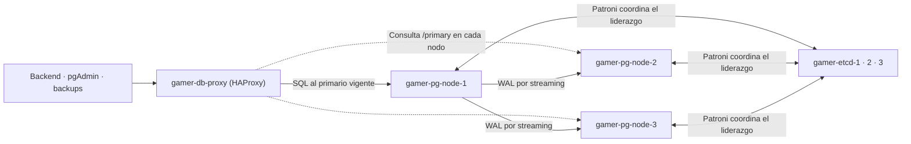
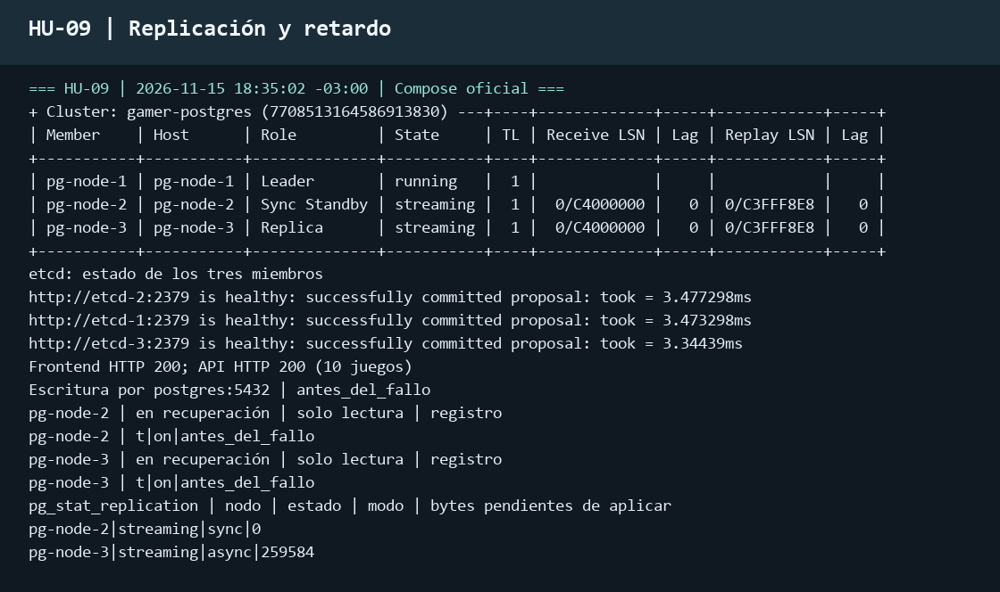

# HU-09 · Clúster PostgreSQL con Patroni

El Compose oficial ejecuta PostgreSQL 16 en tres nodos. Uno recibe las escrituras y dos replican el WAL por streaming. Los tres tienen la misma configuración y pueden cambiar de rol. El backend, pgAdmin y el servicio de backups conservan la dirección `postgres:5432`.

## Arquitectura implementada



El diagrama ilustra el caso en que `pg-node-1` es primario. Los números identifican contenedores y el rol se consulta en Patroni. Los miembros etcd conservan el registro del liderazgo en volúmenes propios y necesitan dos de tres para formar mayoría. El backend se conecta a HAProxy, que verifica `/primary` en cada Patroni y acepta como destino al nodo que tiene el liderazgo y responde como primario. Las APIs de Patroni y etcd quedan en redes Docker. El único puerto SQL publicado escucha en `127.0.0.1` con el puerto de `POSTGRES_PORT`.

## Inicialización y configuración

1. Configurar el `.env` local a partir de `.env.example`, o agregar `PATRONI_REPLICATION_PASSWORD` al archivo existente con una contraseña aleatoria propia. Patroni crea el rol de replicación `replicador`. Usar las mismas credenciales para los tres nodos, mediante las variables compartidas de Compose.
2. Desde la raíz del repositorio, arrancar el entorno con el Compose oficial.

   ```powershell
   docker compose up -d --build --wait --wait-timeout 900 frontend pgadmin backups
   docker compose exec -T pg-node-1 patronictl -c /etc/patroni.yml list
   ```

3. En un primer arranque, el nodo que gana el bloqueo de inicialización crea la base y ejecuta el esquema de HU-06, el seed de seis millones de reseñas y los índices de HU-08. Ese arranque tarda varios minutos según el disco. Patroni usa `pg_basebackup` para clonar ambos secundarios y mantiene slots de replicación. En arranques posteriores se reutilizan los datos y metadatos persistentes.

La fuente de configuración es [patroni.yml](../../db-scripts/cluster/patroni.yml). Al inicializar la base se activan los checksums para habilitar `pg_rewind`. Patroni administra `pg_hba.conf`, habilita las conexiones del rol de replicación y exige autenticación SCRAM. PostgreSQL usa `wal_level=replica`, hasta diez emisores WAL y diez slots. `archive_mode` queda en `off` porque la topología utiliza streaming y slots, sin un destino de archivado WAL. El servicio HU-07 sigue generando backups lógicos.

En operación normal, Patroni configura una réplica síncrona y mantiene la otra por streaming. El modo síncrono estricto espera confirmación de al menos un secundario para las escrituras normales. Si ambos secundarios faltan, las escrituras que necesitan confirmación esperan hasta que haya uno disponible. El bootstrap desactiva esa espera en su propia sesión durante la carga inicial y ejecuta un checkpoint al terminar.

### Volumen de la instalación anterior

El clúster usa tres volúmenes nuevos `pg-cluster-node-*`. El volumen histórico `gamer_pgdata` queda disponible para recuperar datos previos. La primera inicialización del clúster carga los datos sintéticos del repositorio. Si hay datos históricos que se deben incorporar, exportarlos desde la instalación anterior y planificar la importación al primario antes de usar el clúster como entorno de trabajo. El seed ocupa las tablas de la aplicación, por lo que un dump completo sobre esa base requiere una restauración planificada. Para detener o recrear contenedores conservando sus datos, usar `docker compose stop` o `docker compose down`.

## Procedimiento de validación

Comprobar en `patronictl list` que haya un nodo con rol `Leader` y dos secundarios en estado `streaming`, uno de ellos con rol `Sync Standby`. Desde el primario, consultar `pg_stat_replication` para ver el estado y la distancia en WAL hasta el último registro aplicado de cada réplica.

```sql
SELECT application_name, state, sync_state,
       pg_wal_lsn_diff(pg_current_wal_lsn(), replay_lsn)::bigint AS bytes_pendientes
FROM pg_stat_replication
ORDER BY application_name;
```

En cada secundario, verificar `pg_is_in_recovery()`, `SHOW transaction_read_only` y la lectura de un registro escrito previamente a través de HAProxy. La distancia en bytes representa el instante de la muestra y puede variar durante la actividad. El procedimiento de escritura, caída y recuperación se detalla en [HU-10](HU-10-FAILOVER-POSTGRESQL.md).

### Resultado en el proyecto oficial

El 15/11/2026, `pg-node-1` se inicializó como primario. `pg-node-2` y `pg-node-3` se conectaron por streaming y leyeron el registro `antes_del_fallo` con `transaction_read_only=on`. La consulta de retardo midió **0 bytes** en el secundario síncrono y **259.584 bytes** en el asíncrono. Los tres miembros de etcd respondieron a `etcdctl endpoint health --cluster`. El frontend y la API respondieron HTTP 200. HU-07 también completó un `pg_dump` de 127.396.993 bytes a través del proxy.



Documentación oficial de [replicación de Patroni](https://patroni.readthedocs.io/en/latest/replication_modes.html) y [clúster etcd en Docker](https://etcd.io/docs/v3.6/op-guide/container/).
