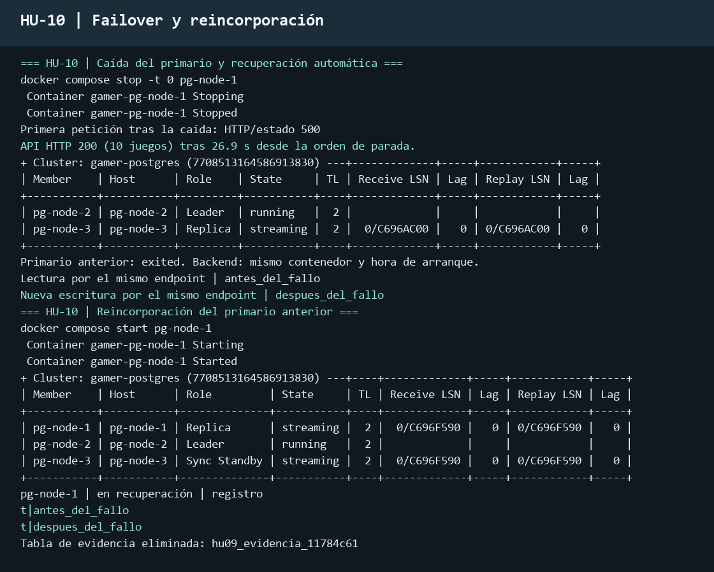

# HU-10 · Failover automático de PostgreSQL

Si cae el primario, Patroni coordina la promoción de un secundario elegible mediante etcd. HAProxy comprueba el endpoint `/primary` de los nodos, cierra conexiones al destino caído y envía las nuevas al primario elegido. La API de Express conserva la misma conexión configurada y el cliente puede reintentar las peticiones que fallaron durante la transición.

## Procedimiento de validación en el Compose oficial

### Prueba automatizada

Con el frontend, backend y los tres nodos activos, ejecutar desde la raíz en PowerShell 7.

```powershell
pwsh -File db-scripts/cluster/verify-failover.ps1
```

La prueba detiene brevemente el primario del entorno oficial. Coordinar la ejecución con los usuarios del entorno. El script crea una tabla de prueba con nombre único y la elimina al finalizar. Obtiene las credenciales de las variables de los contenedores.

### Prueba manual

`-h postgres` conecta por HAProxy desde un contenedor y `-h pg-node-N` conecta al nodo indicado.

```powershell
docker compose exec -T pg-node-1 patronictl -c /etc/patroni.yml list
Invoke-RestMethod 'http://localhost:3000/juego/mas-jugados'
```

1. Identificar el líder y los dos secundarios. Antes de simular la caída, comprobar que los dos secundarios están en streaming y que hay uno síncrono.
2. Escribir un registro en una tabla de prueba por HAProxy y confirmar que se lee en ambos secundarios. Registrar el líder, la línea de tiempo y el estado de los nodos.
3. Detener el primario identificado, sustituyendo el nombre del ejemplo. El plazo cero fuerza la caída del proceso si sigue activo al agotarse la espera.

   ```powershell
   docker compose stop -t 0 pg-node-1
   ```

4. Consultar `patronictl list` desde un nodo superviviente y repetir la petición a la API. Registrar cuánto tiempo tarda en volver la respuesta. Verificar que se puede leer el dato anterior y confirmar una nueva escritura por `postgres:5432` mientras el nodo caído sigue detenido.
5. Reiniciar el nodo detenido con `docker compose start pg-node-1`. Verificar que vuelve como réplica, que existe un único líder y que el nodo reincorporado puede leer la escritura posterior al fallo. El líder nuevo conserva su rol.
6. Eliminar la tabla creada para la prueba.

## Resultado en el proyecto oficial

El 15/11/2026 se detuvo `pg-node-1`. La primera petición a `/juego/mas-jugados` devolvió HTTP 500. Patroni promovió a `pg-node-2` sin intervención y PostgreSQL avanzó de la línea de tiempo 1 a la 2. La API volvió a HTTP 200 en **26,9 segundos desde la orden de parada**, con el mismo contenedor y la misma hora de arranque de Express. Con el primer nodo todavía detenido, el mismo endpoint SQL devolvió `antes_del_fallo` y confirmó `despues_del_fallo`. Al arrancar `pg-node-1`, Patroni ejecutó `pg_rewind` con código de salida 0. El nodo volvió como secundario y leyó ambos registros. Esta medición corresponde a una caída de un nodo en esta máquina.



## Consistencia y límites

- etcd otorga un solo bloqueo de liderazgo mediante mayoría. Patroni exige ese bloqueo para exponer el primario a HAProxy y comprueba la línea de tiempo al elegir al sucesor. El secundario síncrono interviene en la elección para proteger las escrituras confirmadas.
- El tiempo de recuperación incluye la detección del fallo, la elección, la promoción, el sondeo de HAProxy y una conexión nueva. Las conexiones y transacciones que estaban en vuelo pueden fallar. Antes de repetir una escritura cuyo resultado se desconoce, comprobar si quedó confirmada.
- Los contenedores de esta implementación comparten una máquina y un proxy. Una caída de esa máquina o de HAProxy afecta el acceso. Si etcd pierde la mayoría, el clúster deja de poder mantener o elegir un líder operativo.
- Si el anterior primario tiene una historia divergente, Patroni intenta `pg_rewind`. Si permanece fuera del clúster, revisar primero sus logs, la accesibilidad al primario y el estado de etcd. Si hay que resincronizarlo, confirmar el líder y respaldar cualquier dato local necesario antes de reinicializar únicamente la réplica afectada con `patronictl reinit`.

Documentación oficial de la [API de salud de Patroni](https://patroni.readthedocs.io/en/latest/rest_api.html).
