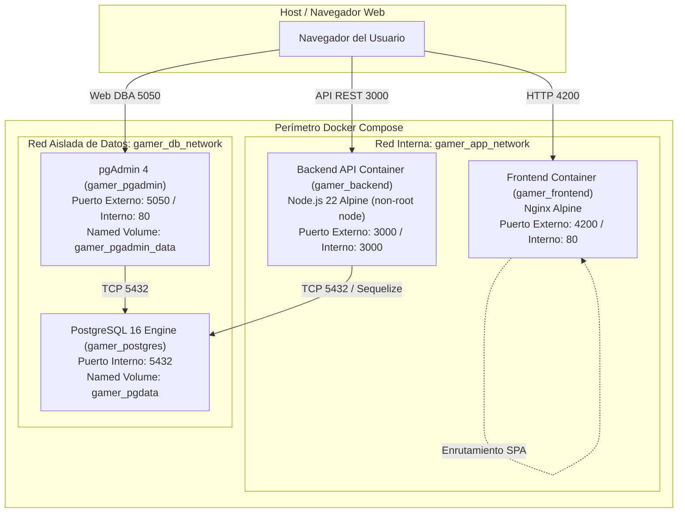

# Historia de Usuario 11: Contenerización Full-Stack (Frontend Angular y Backend Node.js)

**Proyecto:** Red Social Gamer y Catálogo de Videojuegos con Moderación IA  
**Cátedra:** Herramientas Informáticas Avanzadas - Grupo 08  
**Fase / Sprint:** Fase 4 (Sprint 4)  
**Rol:** Desarrollador / Ingeniero Cloud DevOps  
**Historia de Usuario:** HU-11  
**Estado:** Finalizado (Criterios de Aceptación 100% Cumplidos)  

---

## 1. Descripción y Criterios de Aceptación

### Enunciado de la HU:
> *Como desarrollador, quiero dockerizar el Frontend y Backend para empaquetar ambos componentes en contenedores reproducibles, optimizados y seguros para producción.*

### Criterios de Aceptación (según `context.md` e `informe-general.md`):
1. **Frontend Multi-stage Build:**
   - Redactar un `Dockerfile` multi-stage para el Frontend:
     - **Stage 1 (Compilación):** Entorno Node.js (20/22/24 Alpine) para resolver dependencias y compilar la aplicación Angular 21 con Angular CLI en modo producción (`ng build --configuration production`).
     - **Stage 2 (Servidor Web):** Servidor ultraligero Nginx Alpine para servir los archivos estáticos generados y gestionar correctamente las rutas del cliente SPA (`try_files $uri $uri/ /index.html;`) con soporte de compresión gzip.
2. **Backend Optimizado y Non-Root User:**
   - Redactar un `Dockerfile` optimizado para el Backend Node.js/Express 5.
   - Minimizar capas, instalar exclusivamente dependencias de producción (`npm ci --omit=dev`) y limpiar la caché de npm.
   - Configurar la ejecución obligatoria bajo un usuario sin privilegios root (`USER node`, UID 1000) bajo el principio de mínimo privilegio y mitigación de amenazas de escalada.
3. **Orquestación en Docker Compose y Segmentación de Redes:**
   - Integrar ambos servicios en `docker-compose.yml`.
   - Conectar el Frontend a la red `app-network`.
   - Conectar el Backend tanto a `app-network` (para atender peticiones) como a `db-network` (para conectarse al motor PostgreSQL).
   - Aplicar aislamiento de red: la base de datos PostgreSQL permanece aislada en `db-network` e inaccesible directamente desde el contenedor de Frontend.
4. **Inicio Coordinado y Healthchecks:**
   - Implementar `depends_on` con condiciones de salud (`service_healthy`) para garantizar que el Backend espere a que PostgreSQL esté 100% operativo antes de inicializar la sincronización de modelos con Sequelize, y que el Frontend dependa del Backend.
   - Definir healthchecks nativos para Backend y Frontend.
5. **Cero Secretos y Variables Parametrizadas:**
   - Parametrizar todas las credenciales y puertos mediante `.env.example` y variables de entorno externas sin secretos en el repositorio.

---

## 2. Arquitectura de Contenedores



---

## 3. Implementación de los Dockerfiles

### 3.1 Backend (`backend/Dockerfile`)
```dockerfile
# =============================================================================
# Backend Node.js / Express - Imagen optimizada para producción
# =============================================================================
FROM node:22-alpine

# Definir variables de entorno para producción
ENV NODE_ENV=production \
    PORT=3000

# Directorio de trabajo en el contenedor
WORKDIR /app

# Asegurar propiedad del directorio para el usuario sin privilegios root
RUN chown -R node:node /app

# Copiar manifiestos de dependencias con los permisos adecuados
COPY --chown=node:node package*.json ./

# Cambiar a usuario non-root por principios de mínimo privilegio y seguridad (HU-11 / DoD)
USER node

# Instalar dependencias estrictamente de producción y purgar caché
RUN npm ci --omit=dev && npm cache clean --force

# Copiar el código fuente de la aplicación manteniendo los permisos non-root
COPY --chown=node:node . .

# Exponer el puerto del servicio Express
EXPOSE 3000

# Comando de arranque de la aplicación
CMD ["node", "index.js"]
```

### 3.2 Frontend (`frontend/Dockerfile`)
```dockerfile
# =============================================================================
# Stage 1: Compilación de la aplicación Angular con Node.js
# =============================================================================
FROM node:22-alpine AS build

WORKDIR /app

# Copiar manifiestos de dependencias
COPY package*.json ./

# Instalar dependencias respetando el árbol de dependencias
RUN npm ci --legacy-peer-deps

# Copiar el código fuente del frontend
COPY . .

# Compilar para producción (Angular 21 Application Builder)
RUN npm run build -- --configuration production

# =============================================================================
# Stage 2: Servidor web Nginx Alpine de alta eficiencia para producción
# =============================================================================
FROM nginx:alpine

# Copiar configuración personalizada optimizada para SPA y compresión gzip
COPY nginx.conf /etc/nginx/conf.d/default.conf

# Copiar los estáticos compilados desde el Stage 1
COPY --from=build /app/dist/TPFinalFront/browser /usr/share/nginx/html

# Exponer puerto HTTP
EXPOSE 80

# Ejecutar Nginx en foreground
CMD ["nginx", "-g", "daemon off;"]
```

### 3.3 Configuración de Servidor Nginx (`frontend/nginx.conf`)
```nginx
server {
    listen 80;
    server_name localhost;

    root /usr/share/nginx/html;
    index index.html;

    # Compresión Gzip para producción
    gzip on;
    gzip_vary on;
    gzip_min_length 1024;
    gzip_proxied expired no-cache no-store private auth;
    gzip_types
        text/plain
        text/css
        text/xml
        text/javascript
        application/javascript
        application/x-javascript
        application/json
        application/xml
        application/xml+rss
        image/svg+xml;

    # Gestión de rutas SPA (Angular)
    location / {
        try_files $uri $uri/ /index.html;
    }

    # Caché para activos estáticos
    location ~* \.(?:ico|css|js|gif|jpe?g|png|woff2?|eot|ttf|svg)$ {
        expires 6M;
        access_log off;
        add_header Cache-Control "public, max-age=15552000, immutable";
    }

    # Desactivar logs de peticiones secundarias
    location = /favicon.ico {
        log_not_found off;
        access_log off;
    }

    location = /robots.txt {
        log_not_found off;
        access_log off;
    }

    # Páginas de error estándar
    error_page 500 502 503 504 /50x.html;
    location = /50x.html {
        root /usr/share/nginx/html;
    }
}
```

---

## 4. Orquestación en Docker Compose (`docker-compose.yml`)

```yaml
services:
  # ---------------------------------------------------------------------------
  # HU-04 | PostgreSQL 16 - Motor Relacional con persistencia y healthcheck
  # ---------------------------------------------------------------------------
  postgres:
    image: postgres:16-alpine
    container_name: gamer_postgres
    restart: unless-stopped
    environment:
      POSTGRES_DB: ${POSTGRES_DB:-tpfinalbackend}
      POSTGRES_USER: ${POSTGRES_USER:-gamer_admin}
      POSTGRES_PASSWORD: ${POSTGRES_PASSWORD:-gamer_secret_password_2026}
      POSTGRES_INITDB_ARGS: "--encoding=UTF8 --locale=C"
      TZ: ${TZ:-America/Argentina/Buenos_Aires}
    ports:
      - "127.0.0.1:${POSTGRES_PORT:-5433}:5432"
    volumes:
      - pgdata:/var/lib/postgresql/data
    networks:
      - db-network
    healthcheck:
      test: ["CMD-SHELL", "pg_isready -U ${POSTGRES_USER:-gamer_admin} -d ${POSTGRES_DB:-tpfinalbackend}"]
      interval: 10s
      timeout: 5s
      retries: 5
      start_period: 20s
    deploy:
      resources:
        limits:
          memory: 2G

  # ---------------------------------------------------------------------------
  # HU-05 | pgAdmin4 - Cliente web de administración de base de datos
  # ---------------------------------------------------------------------------
  pgadmin:
    image: dpage/pgadmin4:latest
    container_name: gamer_pgadmin
    restart: unless-stopped
    environment:
      PGADMIN_DEFAULT_EMAIL: ${PGADMIN_DEFAULT_EMAIL:-admin@gamer.com}
      PGADMIN_DEFAULT_PASSWORD: ${PGADMIN_DEFAULT_PASSWORD:-gamer_admin_password_2026}
      PGADMIN_CONFIG_SERVER_MODE: "False"
      PGADMIN_CONFIG_MASTER_PASSWORD_REQUIRED: "False"
      TZ: ${TZ:-America/Argentina/Buenos_Aires}
    ports:
      - "127.0.0.1:${PGADMIN_PORT:-5050}:80"
    volumes:
      - pgadmin_data:/var/lib/pgadmin
      - ./pgadmin/servers.json:/pgadmin4/servers.json:ro
    networks:
      - db-network
    depends_on:
      postgres:
        condition: service_healthy

  # ---------------------------------------------------------------------------
  # HU-11 | Backend API (Node.js / Express 5) - Ejecución non-root optimizada
  # ---------------------------------------------------------------------------
  backend:
    build:
      context: ./backend
      dockerfile: Dockerfile
    image: gamer-backend:production
    container_name: gamer_backend
    restart: unless-stopped
    environment:
      NODE_ENV: production
      PORT: 3000
      DB_HOST: postgres
      DB_PORT: 5432
      DB_NAME: ${POSTGRES_DB:-tpfinalbackend}
      DB_USER: ${POSTGRES_USER:-gamer_admin}
      DB_PASSWORD: ${POSTGRES_PASSWORD:-gamer_secret_password_2026}
      JWT_SECRET: ${JWT_SECRET:-super_secret_jwt_token_for_gamer_social_2026}
      SESSION_SECRET: ${SESSION_SECRET:-super_secret_session_key_gamer_app_2026}
      FRONTEND_URL: ${FRONTEND_URL:-http://localhost:4200}
      GOOGLE_CLIENT_ID: ${GOOGLE_CLIENT_ID}
      GOOGLE_CLIENT_SECRET: ${GOOGLE_CLIENT_SECRET}
      GOOGLE_CALLBACK_URL: ${GOOGLE_CALLBACK_URL}
      IGDB_CLIENT_ID: ${IGDB_CLIENT_ID}
      IGDB_CLIENT_SECRET: ${IGDB_CLIENT_SECRET}
      GEMINI_API_KEY: ${GEMINI_API_KEY}
    ports:
      - "${BACKEND_PORT:-3000}:3000"
    networks:
      - app-network
      - db-network
    depends_on:
      postgres:
        condition: service_healthy
    healthcheck:
      test: ["CMD", "node", "-e", "require('http').get('http://127.0.0.1:3000/api-docs/', (res) => { process.exit(res.statusCode === 200 ? 0 : 1); }).on('error', () => process.exit(1));"]
      interval: 10s
      timeout: 5s
      retries: 5
      start_period: 15s
    deploy:
      resources:
        limits:
          memory: 1G

  # ---------------------------------------------------------------------------
  # HU-11 | Frontend Web (Angular 21 / Nginx Alpine) - Multi-stage build
  # ---------------------------------------------------------------------------
  frontend:
    build:
      context: ./frontend
      dockerfile: Dockerfile
    image: gamer-frontend:production
    container_name: gamer_frontend
    restart: unless-stopped
    ports:
      - "${FRONTEND_PORT:-4200}:80"
    networks:
      - app-network
    depends_on:
      backend:
        condition: service_healthy
    healthcheck:
      test: ["CMD-SHELL", "wget --no-verbose --tries=1 --spider http://127.0.0.1:80/ || exit 1"]
      interval: 10s
      timeout: 5s
      retries: 3
      start_period: 10s
    deploy:
      resources:
        limits:
          memory: 512M

volumes:
  pgdata:
    name: gamer_pgdata
  pgadmin_data:
    name: gamer_pgadmin_data

networks:
  app-network:
    name: gamer_app_network
    driver: bridge
  db-network:
    name: gamer_db_network
    driver: bridge
```

---

## 5. Procedimiento de Ejecución y Validación

1. **Configurar el entorno:**
   ```powershell
   Copy-Item .env.example .env
   ```
2. **Levantar todos los servicios coordinadamente:**
   ```powershell
   docker compose up -d --build
   ```
3. **Verificar el estado de salud de los contenedores:**
   ```powershell
   docker compose ps
   ```
   *Salida verificada:*
   - `gamer_postgres`: `Up (healthy)`
   - `gamer_backend`: `Up (healthy)`
   - `gamer_frontend`: `Up (healthy)`
   - `gamer_pgadmin`: `Up`
4. **Verificar logs del backend y conexión exitosa a PostgreSQL:**
   ```powershell
   docker logs gamer_backend
   ```
   *Salida comprobada:*
   ```text
   DB conectada con PostgreSQL (postgres:5432/tpfinalbackend)
   Tablas de PostgreSQL sincronizadas
   Servidor corriendo en el puerto 3000
   ```
5. **Verificar acceso en navegador local:**
   - **Frontend Web:** `http://localhost:4200` (Responde HTTP 200)
   - **Backend API Docs:** `http://localhost:3000/api-docs/` (Responde HTTP 200)
   - **pgAdmin 4:** `http://localhost:5050` (Responde HTTP 200)

---

## 6. Cumplimiento de Criterios de Aceptación y DoD

- [x] **Dockerfile multi-stage para Frontend:** Stage 1 de compilación con Node.js y Angular CLI; Stage 2 ligero con Nginx Alpine y enrutamiento SPA. Tamaño final en disco de solo 27.3 MB.
- [x] **Dockerfile optimizado para Backend:** Base Node.js 22 Alpine, capas optimizadas, solo dependencias de producción y ejecutándose bajo usuario non-root (`node`).
- [x] **Orquestación en Docker Compose:** Integración completa de Frontend, Backend, PostgreSQL y pgAdmin.
- [x] **Segmentación de redes:** Redes `app-network` y `db-network` aplicadas con éxito.
- [x] **Inicio coordinado y healthchecks:** `depends_on` con `service_healthy` entre PostgreSQL -> Backend -> Frontend.
- [x] **Cero secretos:** Variables parametrizadas en `.env.example` y ningún secreto sensible commiteado.
- [x] **Documentación técnica:** Generada en `docs/historias_usuario/HU-11-DOCKER-APP.md`.
