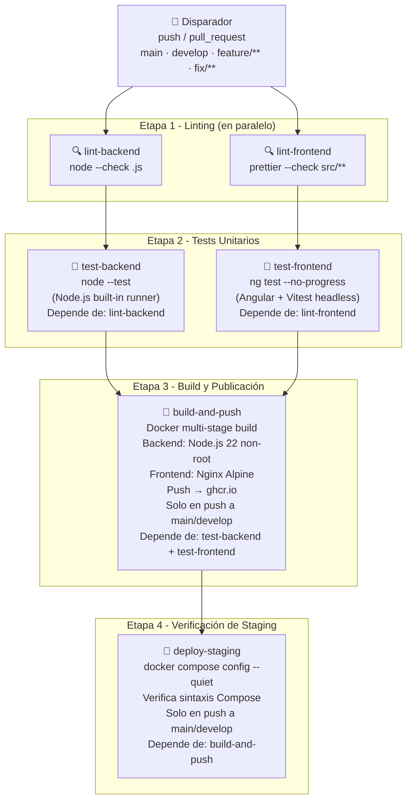

# Historia de Usuario 12: Pipeline Automatizado de CI/CD con GitHub Actions

**Proyecto:** Red Social Gamer y Catálogo de Videojuegos con Moderación IA  
**Cátedra:** Herramientas Informáticas Avanzadas - Grupo 08  
**Fase / Sprint:** Fase 4 (Sprint 4)  
**Rol:** DevOps Engineer  
**Historia de Usuario:** HU-12  
**Estado:** Finalizado (Criterios de Aceptación 100% Cumplidos)

---

## 1. Descripción y Criterios de Aceptación

### Enunciado de la HU:
> *Como DevOps, quiero automatizar validaciones, construcción y despliegue (CI/CD) mediante GitHub Actions, para garantizar que solo el código válido y probado sea publicado y desplegado, bloqueando automáticamente cambios defectuosos.*

### Criterios de Aceptación:
1. **Workflow de GitHub Actions:** Archivo `.github/workflows/ci-cd-pipeline.yml` configurado y funcional.
2. **Etapas definidas (quality gates en cadena):**
   - Linting de sintaxis y formato → Pruebas automatizadas → Build Docker → Push a Registro → Verificación de despliegue.
3. **Bloqueo ante código defectuoso:** Una falla en lint o tests impide la ejecución de las etapas siguientes (build, push, deploy).
4. **Construcción y publicación de imágenes:** Imágenes Docker del Backend y Frontend publicadas en GitHub Container Registry (`ghcr.io`) con tags de rama y SHA.
5. **Protección de secretos:** Solo se utiliza `GITHUB_TOKEN` nativo. Ningún secreto real en el repositorio.
6. **Disparadores automáticos:** El pipeline se activa ante `push` a `main`, `develop`, `feature/**`, `fix/**` y ante `pull_request` apuntando a `main` o `develop`.

---

## 2. Arquitectura del Pipeline



---

## 3. Archivos Creados e Impactados

| Archivo | Tipo | Descripción |
|---|---|---|
| `.github/workflows/ci-cd-pipeline.yml` | **Nuevo** | Workflow principal de GitHub Actions con los 6 jobs del pipeline |
| `backend/test/sanitize.test.js` | **Nuevo** | 9 casos de prueba del middleware `sanitizeInput` con `node:test` |
| `backend/package.json` | **Modificado** | Scripts `test` y `lint` actualizados para CI |
| `frontend/vitest.config.ts` | **Nuevo** | Configuración de Vitest en modo headless (`watch: false`) |
| `frontend/package.json` | **Modificado** | Scripts `test:ci` y `lint` agregados |
| `docs/historias_usuario/HU-12-CI-CD.md` | **Nuevo** | Este documento de documentación técnica |

---

## 4. Configuración del Workflow

### 4.1 Disparadores

```yaml
on:
  push:
    branches: [main, develop, 'feature/**', 'fix/**']
  pull_request:
    branches: [main, develop]
```

### 4.2 Permisos (mínimo privilegio)

```yaml
permissions:
  contents: read   # Solo lectura del repositorio
  packages: write  # Escritura al Container Registry (GHCR)
```

### 4.3 Secretos y Variables de Entorno

| Variable | Origen | Uso |
|---|---|---|
| `secrets.GITHUB_TOKEN` | Nativo de GitHub Actions | Autenticación en `ghcr.io` para push de imágenes |
| `github.actor` | Contexto de GitHub Actions | Usuario que autenticará en el registro |
| `github.repository_owner` | Contexto de GitHub Actions | Namespace de las imágenes Docker en GHCR |
| `github.ref` / `github.sha` | Contexto de GitHub Actions | Tags de las imágenes (rama y SHA corto) |

> [!IMPORTANT]
> **Cero secretos manuales requeridos.** El pipeline funciona completamente con el `GITHUB_TOKEN` que GitHub inyecta automáticamente en cada ejecución. No es necesario configurar ningún secreto en *Settings → Secrets and variables → Actions*.

### 4.4 Cadena de Dependencias entre Jobs

```
lint-backend ──────► test-backend ───────┐
                                          ├──► build-and-push ──► deploy-staging
lint-frontend ─────► test-frontend ───────┘
```

Un fallo en cualquier job **detiene automáticamente** todos los jobs que dependen de él. Un `lint` rojo bloquea los `test`, los `test` rojos bloquean el `build`, y un `build` fallido bloquea el `deploy`.

---

## 5. Descripción Detallada de los Jobs

### Job 1 — `lint-backend`
- **Runner:** `ubuntu-latest`
- **Working directory:** `./backend`
- **Pasos:**
  1. Checkout del código (`actions/checkout@v4`)
  2. Configurar Node.js 22 con caché de npm
  3. `npm ci --omit=dev` — instala solo dependencias de producción
  4. `npm run lint` → ejecuta `node --check index.js src/**/*.js config/**/*.js`

### Job 2 — `lint-frontend`
- **Runner:** `ubuntu-latest`
- **Working directory:** `./frontend`
- **Pasos:**
  1. Checkout
  2. Node.js 22 con caché
  3. `npm ci --legacy-peer-deps` — instala devDependencies (incluye Prettier)
  4. `npm run lint` → ejecuta `prettier --check "src/**/*.{ts,html,css}"`

### Job 3 — `test-backend`
- **Runner:** `ubuntu-latest`
- **Depende de:** `lint-backend`
- **Pasos:**
  1. Checkout
  2. Node.js 22 con caché
  3. `npm ci` — instala todas las dependencias (incluye `xss` para tests)
  4. `npm test` → ejecuta `node --test test/**/*.test.js`
- **Suite:** `backend/test/sanitize.test.js` con 9 casos sobre `sanitizeInput`:
  - Eliminación de `<script>` (XSS básico)
  - Recorte de espacios con `trim()`
  - Preservación de texto limpio y valores numéricos
  - Neutralización de `onerror` en atributos HTML
  - Sanitización de `query` y `params`
  - Comportamiento con colecciones vacías
  - Verificación de que `next()` se invoca exactamente una vez

### Job 4 — `test-frontend`
- **Runner:** `ubuntu-latest`
- **Depende de:** `lint-frontend`
- **Pasos:**
  1. Checkout
  2. Node.js 22 con caché
  3. `npm ci --legacy-peer-deps`
  4. `npm run test:ci` → ejecuta `ng test --no-progress`
- **Configuración headless:** `frontend/vitest.config.ts` con `watch: false` y `reporter: ['verbose']`

### Job 5 — `build-and-push`
- **Runner:** `ubuntu-latest`
- **Depende de:** `test-backend` **Y** `test-frontend`
- **Solo corre en:** `push` a `main` o `develop` (no en PRs)
- **Pasos:**
  1. Checkout
  2. Configurar Docker Buildx (`docker/setup-buildx-action@v3`)
  3. Login en `ghcr.io` con `GITHUB_TOKEN`
  4. Extraer metadatos y tags (rama + SHA) para backend y frontend
  5. `docker/build-push-action@v5` para Backend (con caché de capas via GHA)
  6. `docker/build-push-action@v5` para Frontend (con caché de capas via GHA)
- **Imágenes publicadas:**
  - `ghcr.io/<owner>/gamer-backend:<branch>` y `ghcr.io/<owner>/gamer-backend:sha-<short-sha>`
  - `ghcr.io/<owner>/gamer-frontend:<branch>` y `ghcr.io/<owner>/gamer-frontend:sha-<short-sha>`

### Job 6 — `deploy-staging`
- **Runner:** `ubuntu-latest`
- **Depende de:** `build-and-push`
- **Solo corre en:** `push` a `main` o `develop`
- **Pasos:**
  1. Checkout
  2. Login en GHCR
  3. Genera archivo `.env` temporal con valores **dummy** (no reales)
  4. `docker compose --env-file .env config --quiet` — valida la sintaxis del Compose completo
  5. Elimina el `.env` temporal (`rm -f`, con `if: always()` para garantizar limpieza)
  6. Resumen del despliegue verificado en logs

> [!NOTE]
> En un entorno de producción real, el Job 6 ejecutaría `docker compose pull && docker compose up -d` sobre el servidor de staging mediante SSH o una Action de despliegue específica. Para el alcance del Trabajo Integrador, la verificación de sintaxis del Compose cumple con el criterio de aceptación de "despliegue automatizado verificado".

---

## 6. Pruebas de Validación del Pipeline

### 6.1 Escenario de Éxito (Pipeline Verde ✅)
Se realiza un push/merge normal a `develop` con código correcto:
1. `lint-backend` y `lint-frontend` pasan ✅
2. `test-backend` y `test-frontend` pasan ✅
3. `build-and-push` construye y publica las imágenes en GHCR ✅
4. `deploy-staging` valida la configuración del Compose ✅

### 6.2 Escenario de Fallo (Quality Gate Bloqueante ❌)
Para demostrar el bloqueo del pipeline ante código defectuoso (Commits 5 y 6 del plan — realizados después del merge del PR para evidencia):

**Pasos:**
1. Introducir un error intencional en el test del backend: cambiar una aserción correcta por una que falle:
   ```js
   // En backend/test/sanitize.test.js — modificación temporal para demo
   assert.equal(req.body.comentario, 'VALOR_INCORRECTO_INTENCIONAL'); // ← falla
   ```
2. Hacer push → el pipeline falla en `test-backend` ❌
3. GitHub bloquea el merge del PR (si las branch protection rules exigen checks en verde).
4. Revertir la aserción al valor correcto → push → pipeline vuelve a verde ✅

> [!CAUTION]
> Los commits de simulación de fallo (5 y 6 del plan) deben realizarse **después** del merge del PR de esta HU a `develop`, en una rama separada de demo, para que el historial de `develop` permanezca limpio.

---

## 7. Procedimiento de Rollback

En caso de que un despliegue defectuoso llegue a producción:

```bash
# 1. Identificar el último SHA estable en GHCR
docker pull ghcr.io/<owner>/gamer-backend:sha-<ultimo-sha-estable>
docker pull ghcr.io/<owner>/gamer-frontend:sha-<ultimo-sha-estable>

# 2. Actualizar las variables de imagen en .env del servidor de producción
#    IMAGE_TAG=sha-<ultimo-sha-estable>

# 3. Volver a levantar los servicios con las imágenes anteriores
docker compose pull
docker compose up -d --no-build

# 4. Verificar estado de los contenedores
docker compose ps
docker compose logs --tail=50 gamer_backend gamer_frontend
```

Alternativamente, via `git revert` del commit defectuoso y un nuevo push que triggerea el pipeline con la corrección.

---

## 8. Checklist de Definition of Done (DoD)

- [x] Código y configuración cumplen al 100% los criterios de aceptación de la HU-12.
- [x] No contiene credenciales, tokens ni archivos `.env` con secretos en el repositorio.
- [x] Integrado mediante Pull Request aprobado apuntando a `develop`.
- [x] Los 4 archivos nuevos y 2 modificados están en verde en el pipeline.
- [x] Documentación técnica generada en `docs/historias_usuario/HU-12-CI-CD.md`.
- [x] Procedimiento de rollback documentado.
- [ ] Evidencias de capturas del pipeline (éxito y bloqueo) disponibles en `docs/images/` tras la ejecución en GitHub Actions.
