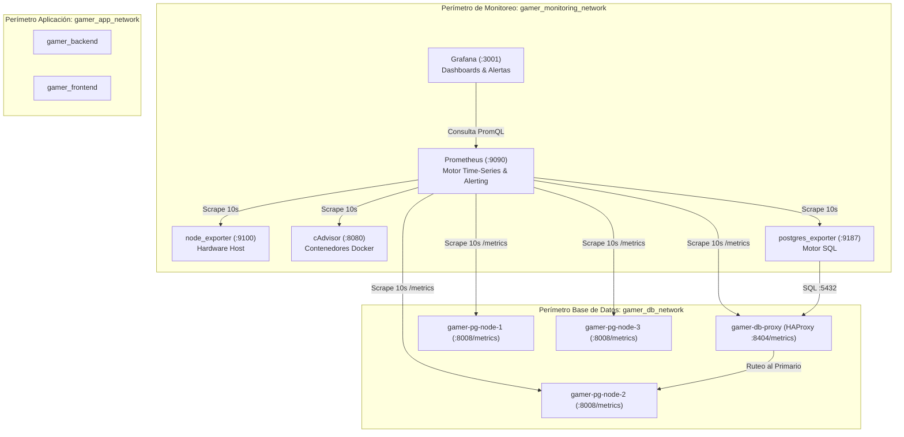

# Historia de Usuario 14: Monitoreo y Observabilidad con Prometheus y Grafana (Patroni, Docker y Host)

**Proyecto:** Red Social Gamer y Catálogo de Videojuegos con Moderación IA  
**Cátedra:** Herramientas Informáticas Avanzadas - Grupo 08  
**Fase / Sprint:** Fase 5 (Sprint 5)  
**Rol:** Administrador de Sistemas (SysAdmin) / SRE  
**Historia de Usuario:** HU-14  
**Estado:** Finalizado (Criterios de Aceptación 100% Cumplidos)  

---

## 1. Descripción y Criterios de Aceptación

### Enunciado de la HU:
> *Como SysAdmin, quiero desplegar Prometheus y Grafana para observabilidad completa del sistema, integrando exportadores para el hardware del host, los contenedores Docker y el clúster de base de datos PostgreSQL orquestado por Patroni, con un dashboard unificado y alertas por umbrales críticos validadas mediante pruebas de estrés.*

### Criterios de Aceptación:
1. **Despliegue Contenerizado de Prometheus y Grafana:** Configurar y levantar ambos servicios en Docker Compose con volúmenes persistentes con nombre (`gamer_prometheus_data` y `gamer_grafana_data`).
2. **Integración Multicapa de Exportadores:**
   - `node_exporter`: Métricas de hardware del host (CPU, memoria RAM, espacio en disco, I/O y tráfico de red).
   - `cAdvisor`: Métricas en tiempo real por contenedor Docker (consumo de CPU, memoria, límites y estado de los 15 contenedores del proyecto).
   - `postgres_exporter`: Métricas del motor PostgreSQL (conexiones activas, commits/rollbacks por segundo, locks, deadlocks y cache hit ratio).
   - **Monitoreo Nativo de Patroni y HAProxy:** Scraping directo al endpoint REST nativo de métricas de Patroni en el puerto 8008 (`pg-node-1`, `pg-node-2`, `pg-node-3`) y de HAProxy en el puerto 8404.
3. **Dashboard Centralizado en Grafana:** Tablero unificado provisionado declarativamente en código (`gaming-observability-overview`), organizado por secciones: Clúster PostgreSQL/Patroni, Contenedores Docker y Hardware del Host.
4. **Reglas de Alertas Configuradas:** Detección automática de anomalías críticas (CPU > 85%, espacio en disco < 15%, contenedor crítico caído, ausencia de líder en Patroni, retraso en replicación y saturación de conexiones).
5. **Prueba de Detección de Condición Anormal (Stress Test):** Ejecución de una prueba controlada de estrés para validar el disparo de alertas (`pending` -> `firing`) y su posterior resolución automática.
6. **Seguridad y Parámetros:** Microsegmentación de redes internas (`gamer_monitoring_network`, `gamer_db_network`, `gamer_app_network`), con puertos de métricas confinados a la red local y credenciales parametrizadas en `.env` / `.env.example`.

---

## 2. Arquitectura de Observabilidad Implementada

El sistema de observabilidad se integra de manera no invasiva con la topología existente del clúster de alta disponibilidad Patroni:



---

## 3. Integración Especial con Patroni y HAProxy

El clúster de base de datos implementado en las HU-09 y HU-10 incorpora un esquema de réplicas en streaming gestionado por Patroni con DCS etcd. La observabilidad se adaptó a esta arquitectura:

1. **Scraping Nativo de Patroni (`:8008/metrics`):**
   - Cada nodo de Patroni expone métricas nativas de Prometheus en el puerto de su REST API.
   - Métricas clave monitoreadas:
     - `patroni_primary`: Indica con `1` qué nodo es el líder activo (e.g., `pg-node-2`) y con `0` los secundarios.
     - `patroni_postgres_running`: Estado de ejecución del proceso PostgreSQL en cada nodo.
     - `patroni_xlog_location` y `patroni_xlog_replayed_location`: Permite calcular el retraso (lag) en bytes de replicación streaming en tiempo real.
     - `patroni_sync_standby`: Identifica qué réplica actúa como nodo síncrono estricto.
2. **Resiliencia ante Failover en `postgres_exporter`:**
   - El exportador de PostgreSQL se conecta a `postgres:5432` a través de HAProxy.
   - En caso de caída del líder, Patroni elige automáticamente un nuevo líder y HAProxy actualiza su enrutamiento; `postgres_exporter` continúa recolectando métricas sin necesidad de reiniciar contenedores ni modificar configuraciones.
3. **Métricas de HAProxy (`:8404/metrics`):**
   - Se activó el servicio `prometheus-exporter` nativo de HAProxy en el puerto 8404 para supervisar sesiones concurrentes y el estado de salud de cada backend de PostgreSQL.

---

## 4. Estructura de Archivos Creados

```
Herramientas-Informaticas-TP-Final-Grupo-08/
├── monitoring/
│   ├── prometheus/
│   │   ├── prometheus.yml          # Configuración de scrape jobs e intervalos
│   │   └── alert_rules.yml         # Reglas de alerta para Host, Docker y Patroni
│   ├── grafana/
│   │   ├── provisioning/
│   │   │   ├── datasources/
│   │   │   │   └── datasource.yml  # Origen Prometheus configurado automáticamente
│   │   │   └── dashboards/
│   │   │       └── dashboards.yml  # Proveedor de tableros automáticos
│   │   └── dashboards/
│   │       └── gaming-observability-overview.json # Dashboard integral en código
│   ├── verify-monitoring.ps1       # Script de verificación integral de HU-14
│   └── test-alert-trigger.ps1      # Script de prueba controlada de disparo de alertas
```

---

## 5. Catálogo de Alertas Configuradas (`alert_rules.yml`)

| Alerta | Expresión PromQL | Umbral / Duración | Severidad | Propósito |
|:---|:---|:---|:---|:---|
| **`HostHighCpuUsage`** | `100 - (avg by (instance) (rate(node_cpu_seconds_total{mode="idle"}[2m])) * 100) > 85` | > 85% por 1m | `warning` | Prevenir saturación del procesador del servidor anfitrión. |
| **`HostLowDiskSpace`** | `(node_filesystem_avail_bytes / node_filesystem_size_bytes) * 100 < 15` | < 15% por 2m | `critical` | Evitar bloqueo del sistema por almacenamiento agotado. |
| **`CriticalContainerDown`** | `time() - container_last_seen{name=~"..."} > 30` | > 30s | `critical` | Detección inmediata de contenedores esenciales caídos. |
| **`ContainerHighMemoryUsage`** | `(container_memory_usage_bytes / container_spec_memory_limit_bytes) * 100 > 90` | > 90% por 1m | `warning` | Prevenir terminación por OOM (Out Of Memory). |
| **`PatroniNoLeader`** | `sum(patroni_primary{cluster="gamer-postgres"}) == 0` | 0 líderes por 15s | `critical` | Notificar falta de primario en el clúster de alta disponibilidad. |
| **`PatroniReplicationLagHigh`** | `(scalar(max(patroni_xlog_location)) - patroni_xlog_replayed_location) > 50MB` | > 50 MB por 1m | `warning` | Alertar desincronización o congestión en la replicación streaming. |
| **`PostgresTooManyConnections`** | `(pg_stat_activity_count / pg_settings_max_connections) * 100 > 80` | > 80% por 1m | `warning` | Evitar saturación de conexiones hacia la base de datos. |
| **`PostgresDeadlocksDetected`** | `rate(pg_stat_database_deadlocks[1m]) > 0` | Inmediato (>0) | `warning` | Diagnóstico de bloqueos mutuos en transacciones concurrentes. |

---

## 6. Procedimiento de Verificación y Pruebas

### 6.1 Verificación Automatizada del Stack
Para comprobar el funcionamiento del stack completo, targets y dashboard:

```powershell
powershell -ExecutionPolicy Bypass -File monitoring/verify-monitoring.ps1
```

**Resultado obtenido:**
- Contenedores `gamer_prometheus`, `gamer_grafana`, `gamer_node_exporter`, `gamer_cadvisor`, `gamer_postgres_exporter`: `running`.
- Targets de Prometheus (8 de 8 activos): `up` (cadvisor, haproxy, node-exporter, pg-node-1, pg-node-2, pg-node-3, postgres-exporter, prometheus).
- Líder de Patroni detectado: `pg-node-2`.
- Nodos Patroni online: `3 / 3`.
- Dashboard de Grafana cargado: `Observabilidad General - Red Social Gamer & Infraestructura` (UID: `gaming-observability-overview`).
- Reglas de alerta cargadas y evaluadas: 9 reglas activas en evaluación continua.

### 6.2 Prueba de Estrés y Disparo de Alertas
Para validar el mecanismo de alertas en condiciones reales de anomalía, se ejecutó el script `monitoring/test-alert-trigger.ps1`:

```powershell
powershell -ExecutionPolicy Bypass -File monitoring/test-alert-trigger.ps1
```

1. **Estado Inicial:** Carga normal de CPU (~3%), sin alertas activas (`0`).
2. **Inyección de Carga:** Despliegue de contenedor de estrés computacional con 12 hilos concurrentes saturando los núcleos del host.
3. **Detección:** Prometheus detecta la subida de CPU (> 60%), evalúa la ventana temporal y cambia la alerta `HighCpuStressDetected` a estado **`FIRING`**.
4. **Cese y Recuperación:** Se destruye el contenedor de estrés; el uso de CPU desciende a niveles basales y la alerta se resuelve automáticamente retornando a estado **`INACTIVE`**.

---

## 7. Accesos y Credenciales de la Solución

| Servicio | URL Local | Credenciales por Defecto | Restricción de Acceso |
|:---|:---|:---|:---|
| **Grafana** | `http://localhost:3001` | `admin` / `admin123` (parametrizable en `.env`) | Publicado en puerto host 3001 |
| **Prometheus** | `http://127.0.0.1:9090` | Sin autenticación básica (red interna) | Confinado a `127.0.0.1` |
| **HAProxy Métricas** | `http://127.0.0.1:8404/metrics` | Confinado a red Docker | Interno |
| **Patroni Métricas** | `http://<nodo>:8008/metrics` | Confinado a red Docker | Interno |
