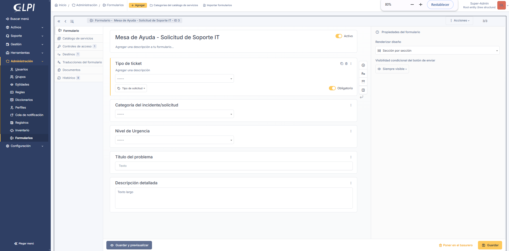
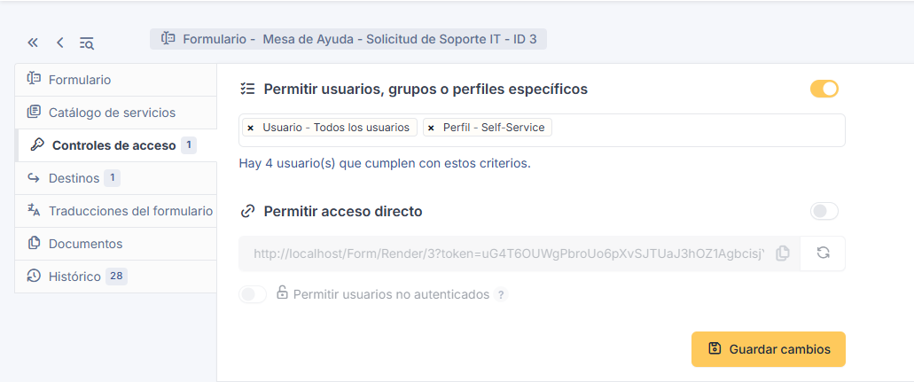
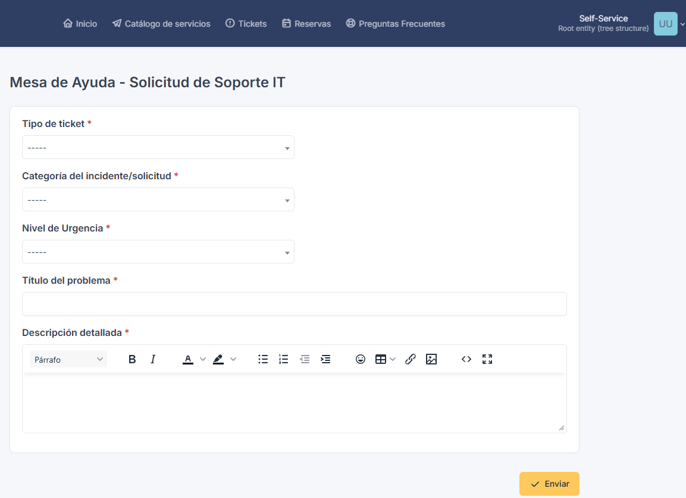

# Historia de Usuario 15: Despliegue de Mesa de Ayuda (GLPI) y Formulario Self-Service Personalizado

**Proyecto:** Red Social Gamer y Catálogo de Videojuegos con Moderación IA  
**Cátedra:** Herramientas Informáticas Avanzadas - Grupo 08  
**Fase / Sprint:** Fase 5 (Sprint 5)  
**Rol:** Analista de Soporte IT / SysAdmin  
**Historia de Usuario:** HU-15  
**Estado:** Finalizado (Criterios de Aceptación 100% Cumplidos)  

---

## 1. Descripción y Criterios de Aceptación

### Enunciado de la HU:
> *Como analista de soporte, quiero desplegar GLPI y personalizar el formulario de tickets para brindar un canal formal y estructurado de mesa de ayuda a los usuarios y administradores de la plataforma gamer.*

### Criterios de Aceptación (según `context.md` e `informe-general.md`):
1. **Infraestructura Contenerizada:** Desplegar la plataforma GLPI mediante contenedor Docker acompañado de su propia base de datos dedicada (MariaDB), en una red interna bridge aislada y con volúmenes persistentes con nombre.
2. **Seguridad y Cero Secretos:** Parametrizar contraseñas y credenciales sensibles a través de variables de entorno externas (`.env`), proveyendo una plantilla `.env.example` en el repositorio sin secretos expuestos.
3. **Formulario Self-Service Personalizado:**
   - Crear un formulario unificado de autoservicio para usuarios finales (*Self-Service*).
   - Establecer como mandatorios y obligatorios los campos:
     - **Tipo:** Selector explícito para distinguir entre `Incidencia` vs `Solicitud`.
     - **Categoría:** Selector de categoría ITIL vinculada a los módulos reales del sistema gamer.
     - **Urgencia:** Selector de nivel de urgencia ITIL.
   - Desactivar los formularios genéricos por defecto para evitar ambigüedades operativas.
4. **Validación Funcional:** Comprobar con un usuario de perfil Self-Service (`post-only`) que el formulario aplique validación estricta (asteriscos obligatorios `*` y bloqueo de envío ante campos vacíos).

---

## 2. Arquitectura de Despliegue en Docker Compose

Se empleó la imagen oficial **`glpi/glpi:latest`** junto con **`mariadb:10.11`**. Esta configuración aprovecha el mecanismo de autoinstalación CLI del contenedor oficial (`bin/console database:install`), permitiendo un aprovisionamiento totalmente automatizado, seguro y reproducible.

### 2.1 Variables de Entorno (`.env.example`)
```env
# ==========================================
# GLPI & MariaDB (Helpdesk - HU-15)
# ==========================================
GLPI_DB_ROOT_PASSWORD=root_password_change_me
GLPI_DB_NAME=glpi_db
GLPI_DB_USER=glpi_user
GLPI_DB_PASSWORD=glpi_password_change_me
GLPI_PORT=8080
```

### 2.2 Definición de Servicios (`docker-compose.yml`)
```yaml
services:
  glpi-db:
    image: mariadb:10.11
    container_name: glpi-db
    restart: unless-stopped
    command: --character-set-server=utf8mb4 --collation-server=utf8mb4_unicode_ci
    environment:
      MYSQL_ROOT_PASSWORD: ${GLPI_DB_ROOT_PASSWORD}
      MYSQL_DATABASE: ${GLPI_DB_NAME}
      MYSQL_USER: ${GLPI_DB_USER}
      MYSQL_PASSWORD: ${GLPI_DB_PASSWORD}
    volumes:
      - glpi_db_data:/var/lib/mysql
    networks:
      - glpi-network
    healthcheck:
      test: ["CMD", "mariadb-admin", "ping", "-h", "localhost", "-u", "${GLPI_DB_USER}", "--password=${GLPI_DB_PASSWORD}"]
      interval: 10s
      timeout: 5s
      retries: 5

  glpi:
    image: glpi/glpi:latest
    container_name: glpi-app
    restart: unless-stopped
    depends_on:
      glpi-db:
        condition: service_healthy
    ports:
      - "${GLPI_PORT:-8080}:80"
    environment:
      TIMEZONE: America/Argentina/Buenos_Aires
      GLPI_DB_HOST: glpi-db
      GLPI_DB_PORT: 3306
      GLPI_DB_NAME: ${GLPI_DB_NAME}
      GLPI_DB_USER: ${GLPI_DB_USER}
      GLPI_DB_PASSWORD: ${GLPI_DB_PASSWORD}
    volumes:
      - glpi_data:/var/glpi
    networks:
      - glpi-network

volumes:
  glpi_db_data:
    name: glpi_db_data
  glpi_data:
    name: glpi_data

networks:
  glpi-network:
    name: glpi-network
    driver: bridge
```

---

## 3. Parametrización en la Interfaz Web de GLPI

Para satisfacer los requerimientos de la cátedra con máxima claridad y usabilidad, se implementó un formulario centralizado mediante el diseñador nativo de GLPI 10:

### 3.1 Carga de Categorías ITIL del Ecosistema Gamer
En `Configuración > Desplegables > Categorías de tickets / peticiones`, se crearon las categorías operativas representativas de la plataforma:
- **`Problemas con Catálogo / IGDB`:** Errores de sincronización con la API de videojuegos o metadatos faltantes.
- **`Fallo en Autenticación / Login`:** Problemas de inicio de sesión, bloqueo de credenciales o expiración de tokens JWT.
- **`Soporte de Moderación IA`:** Consultas o quejas respecto al filtrado automatizado de contenido de Gemini AI.

Todas configuradas con visibilidad plena tanto para **Incidencias** como para **Peticiones/Solicitudes**.

### 3.2 Desactivación de Formularios Genéricos
En `Administración > Formularios`, se desactivaron los formularios nativos precargados (*Report an issue* y *Request a service*) cambiando su estado a inactivo (`is_active = 0`), eliminando la duplicidad visual en el catálogo de autoservicio.

### 3.3 Creación del Formulario Centralizado: "Mesa de Ayuda - Solicitud de Soporte IT"
En `Administración > Formularios > Añadir`:
1. **Definición de Preguntas y Obligatoriedad:**
   - **`Tipo de ticket`:** Campo tipo *Tipo de petición* (`QuestionTypeRequestType`), con selector visible entre **Incidencia** vs **Solicitud**. Propiedad **Obligatorio = Sí**.
   - **`Categoría del incidente/solicitud`:** Campo tipo *Categoría ITIL* (`QuestionTypeItemDropdown`), enlazado a las categorías creadas. Propiedad **Obligatorio = Sí**.
   - **`Nivel de Urgencia`:** Campo tipo *Urgencia ITIL* (`QuestionTypeUrgency`), permitiendo graduar de Muy baja a Muy alta. Propiedad **Obligatorio = Sí**.
   - **`Título del problema`:** Campo tipo *Texto corto*. Propiedad **Obligatorio = Sí**.
   - **`Descripción detallada`:** Campo tipo *Texto largo*. Propiedad **Obligatorio = Sí**.

2. **Configuración de Destino (Mapeo a Ticket):**
   En la pestaña **Destinos**, se configuró como destino la generación de un **Ticket**, asociando dinámicamente cada respuesta del usuario al atributo correspondiente del ticket de GLPI.

3. **Gobernanza y Accesos:**
   En la pestaña **Accesos**, se concedió visibilidad y autorización de ejecución para usuarios con perfil **Self-Service**.

---

## 4. Evidencias de Validación Técnica

Las evidencias de la configuración y de las pruebas funcionales se encuentran alojadas en `docs/images/hu15/`:

1. **Diseño de Preguntas y Validación Obligatoria:**  
     
   *Muestra el diseñador visual del formulario con las 5 preguntas requeridas marcadas estrictamente como obligatorias.*

2. **Configuración de Destinos y Mapeo del Formulario:**  
     
   *Muestra el destino tipo Ticket donde el Tipo, Categoría, Urgencia, Título y Descripción son inyectados al ciclo de vida ITIL.*

3. **Experiencia del Usuario en Modo Autoservicio (Self-Service):**  
     
   *Comprobación con el usuario `post-only`: formulario unificado y limpio, presencia de asteriscos rojos `*` de obligatoriedad y validación activa ante envíos incompletos.*

---

## 5. Cumplimiento de Criterios de Calidad (Definition of Done)

- [x] **Contenerización reproducible:** Servicios orquestados en Docker Compose con imágenes oficiales y volúmenes nombrados persistentes.
- [x] **Cero secretos:** Variables parametrizadas en `.env` y documentadas en `.env.example`.
- [x] **Formulario Self-Service adaptado:** Selectores explícitos y funcionales para Tipo (Incidencia vs Solicitud), Categoría y Urgencia, todos obligatorios.
- [x] **Evidencias gráficas completas:** Capturas organizadas en `docs/images/hu15/`.
- [x] **Preparación para historias siguientes:** GLPI listo para recibir el registro y trazabilidad de los 10 incidentes reales del proyecto (**HU-16**) y la integración de alertas automáticas mediante n8n (**HU-18**).
