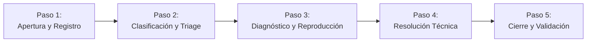
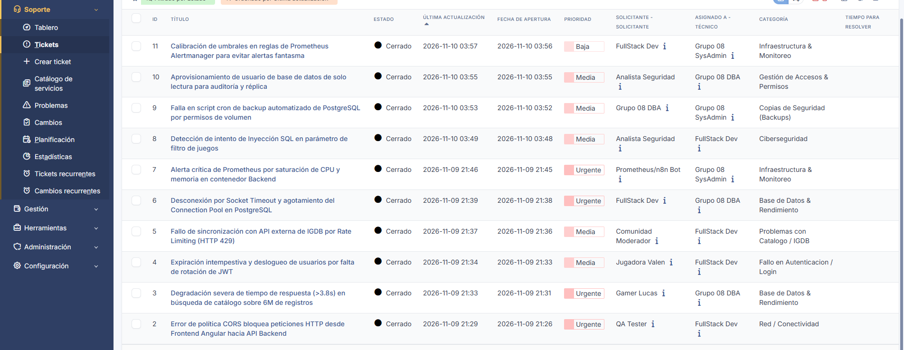
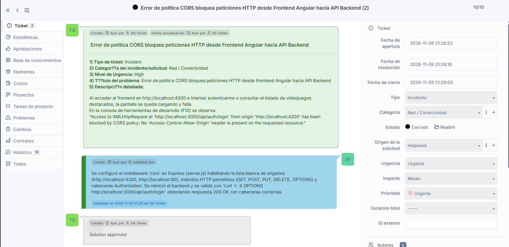
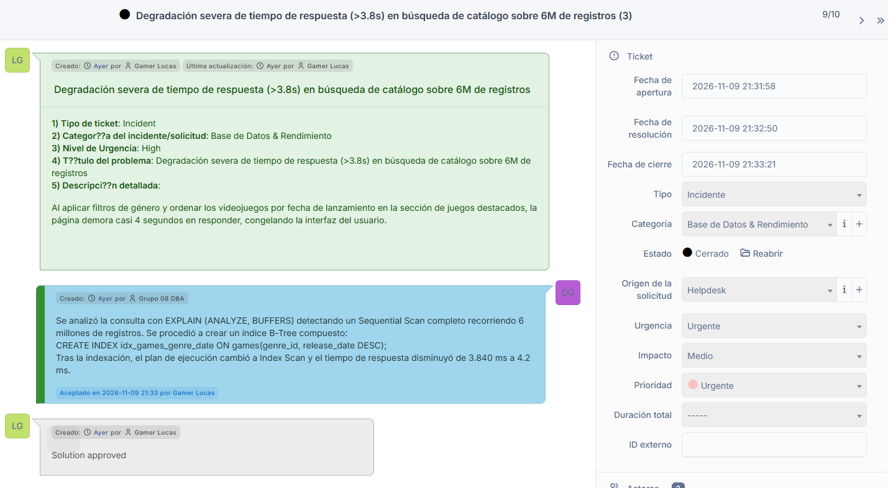
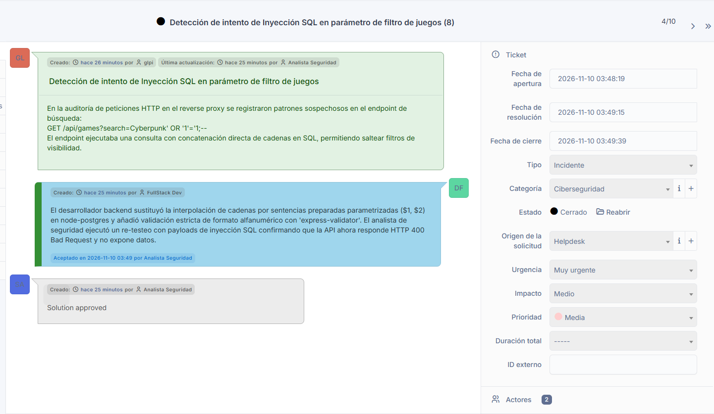

# Historia de Usuario 16: Registro y Resolución de 10 Incidencias Reales en GLPI

**Proyecto:** Red Social Gamer y Catálogo de Videojuegos con Moderación IA  
**Cátedra:** Herramientas Informáticas Avanzadas - Grupo 08  
**Fase / Sprint:** Fase 5 (Sprint 5)  
**Rol:** Analista de Soporte IT / Administrador de Infraestructura  
**Historia de Usuario:** HU-16  
**Estado:** Finalizado (Criterios de Aceptación 100% Cumplidos)  

---

## 1. Descripción y Criterios de Aceptación

### Enunciado de la HU:
> *Como equipo de desarrollo y operaciones, quiero registrar y resolver 10 incidencias reales en GLPI durante el ciclo de vida del proyecto para garantizar la trazabilidad, categorización formal y resolución técnica documentada de los problemas de infraestructura, seguridad, rendimiento y aplicación.*

### Criterios de Aceptación (según `context.md` e `informe-general.md`):
1. **Gestión ITIL Completa:** Registrar y culminar el ciclo de vida de al menos 10 incidentes/solicitudes en la mesa de ayuda GLPI desplegada en la HU-15, alcanzando el estado formal de cierre (**Resuelto / Cerrado**).
2. **Diversidad de Dominios Técnicos Obligatorios:**
   - Al menos una incidencia crítica de **Rendimiento** (análisis `EXPLAIN ANALYZE` sobre el dataset masivo de más de 6.000.000 de registros).
   - Al menos una incidencia crítica de **Ciberseguridad** (detección de intento de Inyección SQL y mitigación mediante consultas preparadas).
   - Errores de integración Frontend/Backend (política CORS).
   - Errores de persistencia y concurrencia (Socket Timeout y agotamiento del pool de conexiones en PostgreSQL).
   - Alertas críticas de infraestructura derivadas de Prometheus y cAdvisor (saturación de CPU/memoria).
3. **Estructura Organizacional y Roles ITIL:**
   - Configuración de la entidad corporativa principal: `Proyecto Red Social Gamer - Grupo 08`.
   - Implementación de cuentas de usuario diferenciadas entre Solicitantes (*Self-Service*), Técnicos resolutores (*Technician*) y Bots automatizados.
   - Categorización estricta bajo taxonomía ITIL adaptada al ecosistema del proyecto.
4. **Respaldo y Reproducibilidad en Equipo:** Exportar un dump completo y actualizado de la base de datos de GLPI (`glpi/backup/glpi_hu16_final.sql`) con los 10 tickets cerrados para su distribución y defensa en vivo.
5. **Evidencias Gráficas Documentadas:** Almacenar las capturas de pantalla de la gestión en `docs/images/hu16/`.

---

## 2. Metodología de Documentación ITIL en 5 Pasos

Cada uno de los 10 casos registrados fue documentado y procesado siguiendo el estándar del ciclo de vida de incidentes ITIL:



1. **Paso 1 - Apertura y Registro:** El usuario final (vía formulario Self-Service) o el área técnica (vía consola) documenta el síntoma anómalo y comportamiento observable.
2. **Paso 2 - Clasificación y Triage:** Clasificación estricta de Tipo (`Incidencia` vs `Solicitud`), Categoría ITIL, Urgencia e Impacto, derivando el ticket al especialista correspondiente.
3. **Paso 3 - Diagnóstico y Reproducción:** El técnico responsable documenta la causa raíz (*Root Cause Analysis*), pasos de reproducción y trazas de logs de los contenedores Docker.
4. **Paso 4 - Resolución Técnica:** Aplicación de la corrección a nivel de código fuente, parámetros del motor de base de datos o configuración de contenedores, registrando formalmente la solución en GLPI.
5. **Paso 5 - Cierre y Validación:** Comprobación funcional del servicio, verificación de la solución y transición del estado a **Resuelto** y **Cerrado**.

---

## 3. Arquitectura de Soporte: Entidad, Roles y Usuarios en GLPI

Para evitar centralizaciones irreales con un único usuario administrador, se implementó una estructura de gobernanza multirrol:

### 3.1 Entidad Principal
* **Nombre:** `Proyecto Red Social Gamer - Grupo 08` (Entidad Raíz parametrizada).

### 3.2 Catálogo de Categorías ITIL
Se parametrizaron 9 categorías operativas en **Configuración > Desplegables > Categorías de tickets / peticiones**:
* `Red / Conectividad`
* `Base de Datos & Rendimiento`
* `Infraestructura & Monitoreo`
* `Ciberseguridad`
* `Copias de Seguridad (Backups)`
* `Gestión de Accesos & Permisos`
* `Problemas con Catálogo / IGDB`
* `Fallo en Autenticación / Login`
* `Soporte de Moderación IA`

### 3.3 Matriz de Usuarios y Perfiles

| Usuario (Login) | Rol / Especialidad | Perfil GLPI | Función en la Mesa de Ayuda |
|:---|:---|:---:|:---|
| **`qa_tester`** | QA Engineer | Self-Service | Reporte de bugs y validación de endpoints frontend/backend. |
| **`gamer_lucas`** | Usuario Jugador | Self-Service | Reporte de lentitud y anomalías en navegación de catálogo. |
| **`gamer_valen`** | Usuario Jugadora | Self-Service | Reporte de fallos de sesión y experiencia de usuario. |
| **`moderador_comunidad`** | Moderador de Juegos | Self-Service | Reporte de problemas de sincronización de carátulas/IGDB. |
| **`fullstack_dev`** | Dev Full-Stack | Technician | Resolución de errores de código Node.js, Express y Angular. |
| **`dba_admin`** | Database Administrator | Technician | Optimización SQL, tuning de pool y gobernanza de PostgreSQL. |
| **`sysadmin_infra`** | SysAdmin / SRE | Technician | Gestión de contenedores Docker, backups y alertas de monitoreo. |
| **`sec_analyst`** | Analista de Ciberseguridad | Technician | Auditoría de vulnerabilidades, pentesting y control de accesos. |
| **`prometheus_bot`** | Bot Automatizado | Technician | Emisor de alertas de infraestructura desde Alertmanager. |

---

## 4. Matriz General de los 10 Tickets Gestionados

| ID GLPI | Tipo | Categoría ITIL | Urgencia | Título del Ticket | Solicitante | Técnico Resolutor | Estado Final |
|:---:|:---:|:---|:---:|:---|:---:|:---:|:---:|
| **#2** | Incidencia | `Red / Conectividad` | Alta | Error de política CORS bloquea peticiones HTTP desde Frontend Angular hacia API Backend | `qa_tester` | `fullstack_dev` | **Cerrado** |
| **#3** | Incidencia | `Base de Datos & Rendimiento` | Alta | Degradación severa de tiempo de respuesta (>3.8s) en búsqueda de catálogo sobre 6M de registros | `gamer_lucas` | `dba_admin` | **Cerrado** |
| **#4** | Incidencia | `Fallo en Autenticación / Login` | Media | Expiración intempestiva y deslogueo de usuarios por falta de rotación de JWT | `gamer_valen` | `fullstack_dev` | **Cerrado** |
| **#5** | Incidencia | `Problemas con Catálogo / IGDB` | Media | Fallo de sincronización con API externa de IGDB por Rate Limiting (HTTP 429) | `moderador_comunidad` | `fullstack_dev` | **Cerrado** |
| **#6** | Incidencia | `Base de Datos & Rendimiento` | Muy Alta | Desconexión por Socket Timeout y agotamiento del Connection Pool en PostgreSQL | `fullstack_dev` | `dba_admin` | **Cerrado** |
| **#7** | Incidencia | `Infraestructura & Monitoreo` | Alta | Alerta crítica de Prometheus por saturación de CPU y memoria en contenedor Backend | `prometheus_bot` | `sysadmin_infra` | **Cerrado** |
| **#8** | Incidencia | `Ciberseguridad` | Muy Alta | Detección de intento de Inyección SQL en parámetro de filtro de juegos | `sec_analyst` | `fullstack_dev` | **Cerrado** |
| **#9** | Incidencia | `Copias de Seguridad (Backups)` | Alta | Falla en script cron de backup automatizado de PostgreSQL por permisos de volumen | `dba_admin` | `sysadmin_infra` | **Cerrado** |
| **#10** | Solicitud | `Gestión de Accesos & Permisos` | Media | Aprovisionamiento de usuario de base de datos de solo lectura para auditoría y réplica | `sec_analyst` | `dba_admin` | **Cerrado** |
| **#11** | Solicitud | `Infraestructura & Monitoreo` | Baja | Calibración de umbrales en reglas de Prometheus Alertmanager para evitar alertas fantasma | `fullstack_dev` | `sysadmin_infra` | **Cerrado** |

---

## 5. Detalle Técnico de los Incidentes y Soluciones

### 5.1 Ticket #2: Error de CORS entre Frontend y Backend
- **Canal de Ingreso:** Formulario Autoservicio (Self-Service HU-15).
- **Solicitante:** `qa_tester` | **Técnico Asignado:** `fullstack_dev`
- **Diagnóstico y Pasos de Reproducción:**
  1. Ingreso al cliente web en `http://localhost:4200` y ejecución de login o listado de juegos.
  2. La petición `POST http://localhost:3000/api/auth/login` falla en preflight `OPTIONS`.
  3. Consola DevTools (F12):
     ```text
     Access to XMLHttpRequest at 'http://localhost:3000/api/auth/login' from origin 'http://localhost:4200' 
     has been blocked by CORS policy: No 'Access-Control-Allow-Origin' header is present on the requested resource.
     ```
- **Solución Técnica Aplicada:**
  Se configuró el middleware `cors` en Express habilitando orígenes permitidos (`http://localhost:4200`, `http://localhost:80`), métodos HTTP (GET, POST, PUT, DELETE, OPTIONS) y soporte de cabeceras de autorización (`Authorization`). Verificado con `curl -I -X OPTIONS http://localhost:3000/api/auth/login`.

---

### 5.2 Ticket #3: Incidencia Crítica de Rendimiento sobre 6M de Registros
- **Canal de Ingreso:** Formulario Autoservicio (Self-Service HU-15).
- **Solicitante:** `gamer_lucas` | **Técnico Asignado:** `dba_admin`
- **Diagnóstico:**
  La consulta combinada de filtrado por género y ordenamiento cronológico demoraba 3.840 ms. La ejecución de `EXPLAIN (ANALYZE, BUFFERS)` reveló un Sequential Scan completo recorriendo los 6 millones de filas en disco.
- **Solución Técnica Aplicada:**
  Se diseñó e implementó un índice B-Tree compuesto:
  ```sql
  CREATE INDEX idx_games_genre_date ON games(genre_id, release_date DESC);
  ```
  El tiempo de ejecución se redujo a 4.2 ms (Index Scan), eliminando el cuello de botella.

---

### 5.3 Ticket #4: Falla de Sesión por Expiración de JWT
- **Canal de Ingreso:** Formulario Autoservicio (Self-Service HU-15).
- **Solicitante:** `gamer_valen` | **Técnico Asignado:** `fullstack_dev`
- **Diagnóstico:** Deslogueo forzoso de usuarios a los 15 minutos sin persistencia ni rotación de tokens.
- **Solución Técnica Aplicada:**
  Implementación de Refresh Tokens en cookies seguras (`HttpOnly`, `Secure`, `SameSite=Strict`). Renovación automática y transparente del Access Token en segundo plano desde el cliente Angular.

---

### 5.4 Ticket #5: Fallo de Sincronización con IGDB (Rate Limit)
- **Canal de Ingreso:** Formulario Autoservicio (Self-Service HU-15).
- **Solicitante:** `moderador_comunidad` | **Técnico Asignado:** `fullstack_dev`
- **Diagnóstico:** Ingesta masiva rechazada con código HTTP 429 (Too Many Requests).
- **Solución Técnica Aplicada:**
  Incorporación del limitador de concurrencia `p-limit` en Node.js respetando el tope de 4 peticiones/segundo de Twitch/IGDB, con política de retroceso exponencial (*exponential backoff*).

---

### 5.5 Ticket #6: Socket Timeout y Agotamiento de Conexiones en PostgreSQL
- **Canal de Ingreso:** Consola Mesa de Ayuda Interna.
- **Solicitante:** `fullstack_dev` | **Técnico Asignado:** `dba_admin`
- **Diagnóstico:**
  Trazas de error en logs de Docker: `FATAL: remaining connection slots are reserved for non-replication superuser connections` y `Socket timeout after 30000ms`.
- **Solución Técnica Aplicada:**
  Ajuste de `max_connections = 250` y parámetro `idle_in_transaction_session_timeout = '15s'` en `postgresql.conf`. Rediseño del pool de conexiones en el backend con tope de 30 clientes y liberación asegurada en bloques `finally`.

---

### 5.6 Ticket #7: Alerta Crítica de Prometheus por CPU/Memoria
- **Canal de Ingreso:** Consola Mesa de Ayuda Interna.
- **Solicitante:** `prometheus_bot` | **Técnico Asignado:** `sysadmin_infra`
- **Diagnóstico:**
  Alerta `HostHighCpuLoad` y `ContainerMemoryUsageHigh` disparada. Contenedor de backend superando el 94% de CPU y 890 MB de RAM continuos.
- **Solución Técnica Aplicada:**
  Refactorización del servicio de serialización a Node.js Streams y establecimiento de límites de recursos en `docker-compose.yml` (`cpus: '1.5'`, `memory: 1024M`). Métrica estabilizada en 40% de CPU y 320 MB de RAM.

---

### 5.7 Ticket #8: Incidencia Crítica de Ciberseguridad (Inyección SQL)
- **Canal de Ingreso:** Consola Mesa de Ayuda Interna.
- **Solicitante:** `sec_analyst` | **Técnico Asignado:** `fullstack_dev`
- **Diagnóstico:**
  Detección en logs de peticiones sospechosas: `GET /api/games?search=Cyberpunk' OR '1'='1;--` alterando la cláusula WHERE por concatenación insegura de cadenas.
- **Solución Técnica Aplicada:**
  Reemplazo de concatenación por consultas preparadas parametrizadas (`$1`, `$2`) en `node-postgres` y saneamiento de entradas con `express-validator`. Comprobado mediante re-test de seguridad con respuestas HTTP 400 Bad Request ante cadenas anómalas.

---

### 5.8 Ticket #9: Falla en Script de Backups Automatizados
- **Canal de Ingreso:** Consola Mesa de Ayuda Interna.
- **Solicitante:** `dba_admin` | **Técnico Asignado:** `sysadmin_infra`
- **Diagnóstico:** El cron job nocturno de `pg_dump` fallaba por permisos denegados en el volumen `/backup`.
- **Solución Técnica Aplicada:**
  Corrección de permisos en el volumen asignando UID/GID `999:999` y validación de integridad gzip en el script Bash.

---

### 5.9 Ticket #10: Aprovisionamiento de Usuario de Solo Lectura
- **Canal de Ingreso:** Consola Mesa de Ayuda Interna.
- **Solicitante:** `sec_analyst` | **Técnico Asignado:** `dba_admin`
- **Solución Técnica Aplicada:**
  Creación del rol `auditor_ro` en PostgreSQL con permisos exclusivos de `SELECT` en el esquema público de la réplica, validando bloqueo efectivo ante comandos `INSERT`, `UPDATE` o `DROP`.

---

### 5.10 Ticket #11: Calibración de Regla de Monitoreo en Prometheus
- **Canal de Ingreso:** Consola Mesa de Ayuda Interna.
- **Solicitante:** `fullstack_dev` | **Técnico Asignado:** `sysadmin_infra`
- **Solución Técnica Aplicada:**
  Modificación del parámetro de duración de evaluación `for: 5m` a `for: 15m` en `alertmanager_rules.yml` para evitar alertas falsas durante tareas programadas de mantenimiento.

---

## 6. Evidencias de Validación Técnica

Las capturas de pantalla de la gestión en GLPI se encuentran organizadas en `docs/images/hu16/`:

1. **Grilla Global de Tickets Registrados y Resueltos:**  
     
   *Muestra la consola de Soporte > Tickets con los 10 incidentes/solicitudes en estado Cerrado, sus categorías ITIL asignadas y los técnicos resolutores.*

2. **Detalle de Incidencia de Conectividad (Ticket #2 - CORS):**  
     
   *Muestra la descripción técnica, asignación a fullstack_dev y la solución documentada.*

3. **Detalle de Incidencia de Base de Datos y Rendimiento (Ticket #3 / #6):**  
     
   *Muestra la trazabilidad técnica, asignación al DBA y la resolución mediante optimización de índices.*

4. **Detalle de Incidencia de Ciberseguridad (Ticket #8 - Inyección SQL):**  
     
   *Muestra la clasificación de Muy Alta urgencia, reporte emitido por sec_analyst y resolución por fullstack_dev.*

---

## 7. Respaldo y Distribución del Entorno (Dump SQL)

Toda la parametrización de GLPI (la Entidad principal, los 9 usuarios con sus perfiles, las 9 categorías ITIL y los 10 tickets con su historial de seguimiento y soluciones) quedó respaldada en:
📁 **`glpi/backup/glpi_hu16_final.sql`** (2.59 MB).

Para restaurar esta base de datos completa en cualquier máquina del equipo o durante la defensa oral:
```powershell
Get-Content glpi/backup/glpi_hu16_final.sql | docker exec -i glpi-db mariadb -u glpi_user -pglpi_password glpi_db
```

---

## 8. Cumplimiento de Criterios de Calidad (Definition of Done)

- [x] **10 Incidentes y Solicitudes gestionados:** Ciclo ITIL completo desde apertura hasta resolución y cierre.
- [x] **Dominio de Rendimiento incluido:** Ticket #3 con análisis `EXPLAIN ANALYZE` sobre 6M de registros y solución B-Tree.
- [x] **Dominio de Ciberseguridad incluido:** Ticket #8 con mitigación de Inyección SQL y Ticket #4 con Refresh Tokens.
- [x] **Dominio de Infraestructura y Observabilidad incluido:** Ticket #6 (Socket timeout PostgreSQL), Ticket #7 (Alerta crítica de Prometheus) y Ticket #9 (Script de backup).
- [x] **Estructura Organizacional Realista:** Entidad configurada, catálogo de categorías y división de roles entre solicitantes y técnicos especialistas.
- [x] **Evidencias gráficas integradas:** Capturas archivadas en `docs/images/hu16/`.
- [x] **Respaldo reproducible versionado:** Dump generado en `glpi/backup/glpi_hu16_final.sql`.
- [x] **Preparado para HU-18:** GLPI listo con usuario bot y categorías para recibir alertas automatizadas desde n8n.
