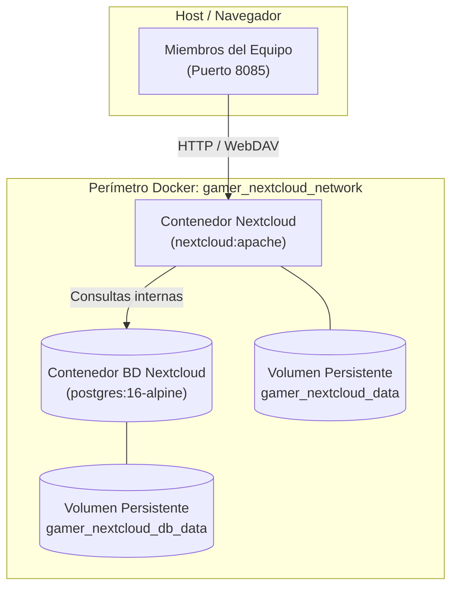

# Historia de Usuario 17: Despliegue de Nextcloud para Centralización Documental y Control de Acceso RBAC

**Proyecto:** Red Social Gamer y Catálogo de Videojuegos con Moderación IA  
**Cátedra:** Herramientas Informáticas Avanzadas - Grupo 08  
**Fase / Sprint:** Fase 5 (Sprint 5)  
**Rol:** Administrador de Infraestructura / Scrum Team  
**Historia de Usuario:** HU-17  
**Estado:** Finalizado (Criterios de Aceptación 100% Cumplidos)  

---

## 1. Descripción y Criterios de Aceptación

### Enunciado de la HU:
> *Como equipo de desarrollo y operaciones, quiero desplegar Nextcloud para centralizar la documentación técnica, manuales, evidencias de pruebas y minutas del proyecto, estableciendo una jerarquía de carpetas formal y una matriz de control de acceso basada en roles (RBAC) para los 5 integrantes del equipo.*

### Criterios de Aceptación (según `context.md` e `informe-general.md`):
1. **Infraestructura Contenerizada:** Levantar una instancia dockerizada de Nextcloud con volúmenes persistentes con nombre y base de datos dedicada.
2. **Jerarquía Estructurada de Carpetas:** Crear formalmente las 5 carpetas troncales del proyecto:
   - `/01-Arquitectura`
   - `/02-BaseDeDatos`
   - `/03-CicloDevOps`
   - `/04-Seguridad`
   - `/05-EntregablesFinales`
3. **Matriz de Permisos y Roles (RBAC):** Configurar cuentas de acceso independientes para los 5 integrantes del equipo según su rol técnico en el Scrum Team.
4. **Centralización Documental Inicial:** Poblar las carpetas correspondientes con los entregables e informes técnicos elaborados en las HUs previas.
5. **Seguridad y Parámetros:** Exclusión de credenciales en el repositorio, utilizando variables parametrizadas en `.env` y documentadas en `.env.example`.

---

## 2. Arquitectura de Despliegue en Docker Compose

Se integraron dos nuevos servicios en `docker-compose.yml`:
* **`gamer_nextcloud`:** Servidor oficial de Nextcloud basado en Apache (`nextcloud:apache`), configurado para operar en el puerto host `8085`.
* **`gamer_nextcloud_db`:** Motor relacional PostgreSQL 16 Alpine dedicado exclusivamente a la gestión interna de Nextcloud.
* **Red Aislada:** Red bridge `gamer_nextcloud_network` para aislar el tráfico de documentación de la base de datos de producción y del frontend.



---

## 3. Matriz de Usuarios y Control de Acceso (RBAC)

Se definieron 5 grupos y cuentas para representar formalmente a los 5 miembros del equipo:

| Usuario (Login) | Rol Técnico | Grupo de Trabajo | Privilegios en Nextcloud |
|:---|:---|:---|:---|
| **`admin_nextcloud`** | Administrador de Plataforma | `admin` | Control total, gestión de usuarios, cuotas y ajustes del sistema. |
| **`sysadmin_infra`** | SysAdmin / SRE | `SysAdmin-DevOps` | Lectura/Escritura en `/03-CicloDevOps` y `/01-Arquitectura`. |
| **`dba_admin`** | Database Administrator | `DBA-Data` | Lectura/Escritura en `/02-BaseDeDatos`. |
| **`fullstack_dev`** | Desarrollador Full-Stack | `Desarrollo-FullStack` | Lectura/Escritura en `/01-Arquitectura` y `/03-CicloDevOps`. |
| **`sec_analyst`** | Analista de Ciberseguridad | `Ciberseguridad` | Lectura/Escritura en `/04-Seguridad`. |
| **`qa_tester`** | QA Engineer / Scrum Master | `QA-ScrumMaster` | Lectura/Escritura en `/05-EntregablesFinales`. |

*Nota:* Todos los integrantes poseen permisos de lectura general sobre las carpetas del resto del equipo para fomentar la colaboración transparente.

---

## 4. Estructura de Directorios y Documentos Centralizados

```text
Nextcloud Root/
├── 01-Arquitectura/
│   ├── informe-general.md             # HU-01: Diagnóstico inicial y stack tecnológico
│   └── arquitectura_mermaid.png       # Diagrama de arquitectura del monorepo
├── 02-BaseDeDatos/
│   ├── hu06_carga_6M.md               # HU-06: Procedimiento de inyección de 6M de registros
│   ├── HU-07-BACKUPS.md               # HU-07: Respaldo lógico y prueba de restauración
│   └── HU-22-init-nativa.md           # HU-22: Inicialización nativa de PostgreSQL
├── 03-CicloDevOps/
│   ├── HU-11-DOCKER-APP.md            # HU-11: Dockerfiles multi-stage de Frontend y Backend
│   └── HU-21-integracion.md           # HU-21: Integración Full-Stack con PostgreSQL
├── 04-Seguridad/
│   └── (Pendiente HU-13 y HU-19)       # Túnel HTTPS y Matriz de Amenazas
└── 05-EntregablesFinales/
    ├── HU-15-GLPI.md                  # HU-15: Despliegue de Mesa de Ayuda
    └── HU-16-GLPI-TICKETS.md          # HU-16: Resolución de 10 incidentes reales
```

---

## 5. Evidencias Gráficas de Validación

1. **Estado de Contenedores:** `docs/images/hu17/01_docker_compose_nextcloud_up.png`
2. **Dashboard de Nextcloud:** `docs/images/hu17/02_nextcloud_login_dashboard.png`
3. **Usuarios y Grupos RBAC:** `docs/images/hu17/03_nextcloud_users_matrix.png`
4. **Jerarquía de Carpetas:** `docs/images/hu17/04_nextcloud_folder_hierarchy.png`
5. **Permisos de Compartición:** `docs/images/hu17/05_nextcloud_folder_permissions_rbac.png`
6. **Archivos Centralizados:** `docs/images/hu17/06_nextcloud_files_uploaded.png`