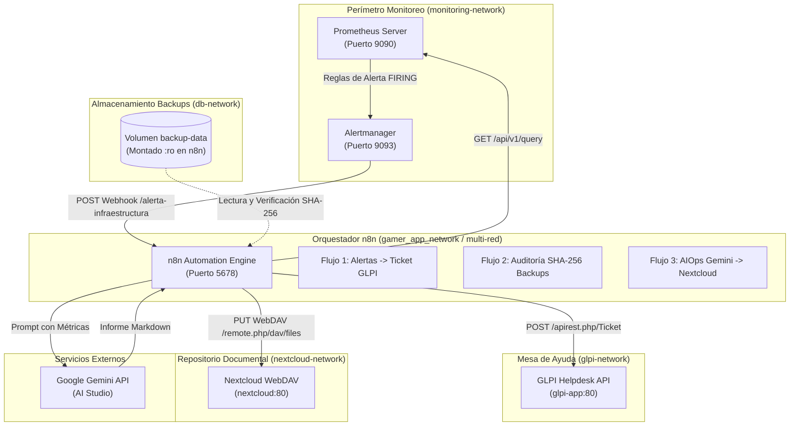

# Historia de Usuario 18: Automatización de Flujos Operativos y AIOps con n8n

**Proyecto:** Red Social Gamer y Catálogo de Videojuegos con Moderación IA  
**Cátedra:** Herramientas Informáticas Avanzadas - Grupo 08  
**Fase / Sprint:** Fase 6 (Sprint 6)  
**Rol:** DevOps Engineer / SysAdmin  
**Historia de Usuario:** HU-18  
**Estado:** Finalizado (Criterios de Aceptación 100% Cumplidos)  

---

## 1. Descripción y Criterios de Aceptación

### Enunciado de la HU:
> *Como DevOps, quiero dockerizar el orquestador de flujos n8n y configurar 3 flujos operativos automatizados (derivación de alertas de infraestructura a tickets en GLPI, verificación criptográfica de backups de base de datos y reporte ejecutivo de rendimiento asistido por Inteligencia Artificial publicado en Nextcloud), garantizando alta disponibilidad, seguridad en credenciales y resiliencia operativa.*

### Criterios de Aceptación:
1. **Contenerización y Persistencia:** Despliegue de n8n y Alertmanager en Docker Compose con autenticación robusta, volúmenes persistentes (`n8n_data`, `alertmanager_data`) y conexión a las redes internas de monitoreo, mesa de ayuda, base de datos y repositorio documental.
2. **Flujo 1 — Alertas de Infraestructura a Mesa de Ayuda:** Webhook receptor de alertas de Prometheus Alertmanager que analiza la severidad técnica, la mapea a la escala de Urgencia ITIL y genera de forma desatendida un ticket formal en GLPI mediante su API REST, manejando el ciclo de vida del token de sesión (`initSession` / `killSession`).
3. **Flujo 2 — Verificación Criptográfica y Notificación de Backups:** Trigger programado que monitorea el volumen persistente de copias de seguridad de PostgreSQL (HU-07), valida que el archivo `.dump` más reciente exista y supere 0 bytes, calcula en tiempo real el Checksum SHA-256 comparándolo contra la firma original, y deriva a GLPI un ticket crítico ante cualquier discrepancia o corrupción.
4. **Flujo 3 — Reporte de Rendimiento Asistido por Inteligencia Artificial (AIOps):** Flujo periódico que consulta métricas clave de saturación desde la API de Prometheus (CPU, RAM, conexiones PostgreSQL y contenedores activos), consulta a la API de Google Gemini (modelo `gemini-3.6-flash`) para elaborar un diagnóstico ejecutivo con recomendaciones y publica automáticamente el informe Markdown en Nextcloud mediante el protocolo WebDAV.
5. **Seguridad y Cero Secretos:** Las claves de API, contraseñas y tokens no se versionan en Git; se parametrizan en `.env` y se documentan en `.env.example`. Los flujos se encuentran respaldados en JSON dentro del repositorio en `n8n/workflows/`.

---

## 2. Arquitectura de Integración en Docker Compose

Para orquestar la automatización se integraron los servicios `n8n` y `alertmanager` en `docker-compose.yml`, vinculándolos a través de redes microsegmentadas:

### Configuración en `docker-compose.yml`:
* **`n8n` (`docker.n8n.io/n8nio/n8n:latest`):** Conectado a `monitoring-network`, `glpi-network`, `nextcloud-network` y `db-network`. Monta el volumen de backups en solo lectura (`backup-data:/backups:ro`) y habilita módulos nativos de Node.js (`NODE_FUNCTION_ALLOW_BUILTIN=fs,path,crypto`).
* **`alertmanager` (`prom/alertmanager:v0.27.0`):** Conectado a `monitoring-network`, despacha las alertas agrupadas hacia el webhook de n8n.

---

## 3. Detalle Técnico de los 3 Flujos Operativos

### 3.1 Flujo 1: Alertas de Prometheus Alertmanager a GLPI Helpdesk
* **Archivo de exportación:** `n8n/workflows/Flujo 1 - Alertas Prometheus a GLPI.json`
* **Trigger:** `Webhook Trigger` escuchando en `POST /webhook/alerta-infraestructura`.
* **Transformación de Datos (Patrón Adapter):**
  * Extrae metadatos (`alertname`, `severity`, `summary`, `description`).
  * Mapea la severidad técnica a la **Urgencia ITIL** de GLPI:
    * `critical` $\rightarrow$ Urgencia **5 (Muy Alta)**.
    * `warning` $\rightarrow$ Urgencia **4 (Alta)**.
  * Compone el título y cuerpo HTML estructurado del incidente.
* **Integración API REST de GLPI:**
  1. `GET /apirest.php/initSession` con credenciales de administrador para obtener el `Session-Token`.
  2. `POST /apirest.php/Ticket` inyectando el token y el cuerpo del ticket con `type: 1` (Incidencia).
  3. `GET /apirest.php/killSession` para destruir la sesión, evitando saturación de memoria y sesiones zombis.
* **Prueba de Validación:** Ejecución controlada mediante `monitoring/test-alert-trigger.ps1`, comprobando la apertura inmediata de la incidencia `[ALERTA INFRAESTRUCTURA] Alerta de estrés: Carga alta de CPU detectada`.

---

### 3.2 Flujo 2: Verificación Criptográfica y Notificación de Backups
* **Archivo de exportación:** `n8n/workflows/Flujo 2 - Verificación y Notificación de Backups.json`
* **Trigger:** `Schedule Trigger` programado de ejecución periódica diaria.
* **Lógica del Auditor Criptográfico:**
  1. **Inspección de Volúmenes:** Escanea `/backups` y selecciona el último archivo `.dump`.
  2. **Validación de Tamaño:** Certifica que el peso sea mayor a 0 bytes (comprueba los ~153.33 MB del dump real).
  3. **Firma Criptográfica:** Localiza el archivo hermano con extensión `.sha256`.
  4. **Cálculo en Tiempo Real:** Procesa el flujo de bytes del `.dump` y calcula el hash SHA-256 (`crypto.createHash('sha256')`).
  5. **Comparación Estricta:** Compara el hash calculado hoy contra el Checksum original de creación.
* **Bifurcación Condicional (Nodo If):**
  * **Rama True (Éxito):** Registra el resultado exitoso con nombre de archivo, peso en MB y hash verificado bajo el principio ITIL de *Alerting by Exception* (evita generar falsas alarmas operativas).
  * **Rama False (Fallo / Corrupción):** Ante discrepancia de firma o archivo vacío, se conecta a GLPI y genera un ticket de Incidencia Crítica (`[CRÍTICO] Fallo de Integridad en Backup PostgreSQL`) con Urgencia Muy Alta (5).

---

### 3.3 Flujo 3: Reporte Ejecutivo de Rendimiento con Gemini AI y Nextcloud
* **Archivo de exportación:** `n8n/workflows/Flujo 3 - Reporte de Rendimiento Asistido por IA.json`
* **Trigger:** `Schedule Trigger` de ejecución periódica (semanal / mensual).
* **Extracción de Telemetría (PromQL):**
  Consulta la API de Prometheus (`http://prometheus:9090/api/v1/query`) para obtener:
  * Utilización de CPU del host (`node_cpu_seconds_total`).
  * Utilización de memoria RAM (`node_memory_MemAvailable_bytes`).
  * Conexiones concurrentes a la base de datos (`pg_stat_activity_count`).
  * Cantidad de contenedores Docker activos monitoreados (`container_last_seen`).
* **Inferencia y AIOps (Google Gemini):**
  Envía la telemetría a la API de Gemini (modelo `gemini-3.6-flash`) con un prompt de rol *SysAdmin Senior*, solicitando diagnóstico de capacidad, detección de cuellos de botella y semáforo de estado de salud.
* **Publicación en Nextcloud (WebDAV):**
  Formatea el reporte en Markdown con marca de tiempo dinámica (`reporte_rendimiento_YYYY-MM-DD_HH-mm.md` para prevenir bloqueos por locks concurrentes de SabreDAV) y lo transfiere a Nextcloud mediante `PUT http://nextcloud/remote.php/dav/files/admin_nextcloud/` con autenticación básica.

---

## 4. Evidencias de Validación Técnica

Las capturas de pantalla de respaldo se organizan en el directorio `docs/images/hu18/`:

| Archivo | Descripción de la Evidencia |
| :--- | :--- |
| `01_n8n_flujo_1_canvas.png` | Diseño visual de los nodos del Flujo 1 en el editor de n8n. |
| `02_n8n_flujo_1_ejecucion.png` | Trazabilidad de ejecución exitosa del Webhook de Alertmanager. |
| `03_glpi_ticket_alerta.png` | Ticket de incidencia creado automáticamente en GLPI ante estrés de CPU. |
| `04_n8n_flujo_2_canvas.png` | Diseño visual de los nodos del Flujo 2 de verificación de backups. |
| `05_n8n_flujo_2_ejecucion_exito.png` | Ejecución exitosa con cálculo y validación del hash SHA-256 (153.33 MB). |
| `06_glpi_ticket_backup_fallo.png` | Ticket de emergencia en GLPI generado ante prueba negativa de corrupción. |
| `07_n8n_flujo_3_canvas.png` | Diseño visual del Flujo 3 de telemetría, Gemini AI y Nextcloud. |
| `08_nextcloud_reporte_ia.png` | Reporte ejecutivo Markdown publicado y visualizado dentro de Nextcloud. |

---

## 5. Cumplimiento de Criterios de Aceptación (Definition of Done)

- [x] **Infraestructura automatizada:** Contenedores `n8n` y `alertmanager` desplegados y operando en Docker Compose con almacenamiento persistente.
- [x] **Flujo 1 operativo:** Alertas de Alertmanager convertidas automáticamente en tickets categorizados en GLPI con gestión de tokens.
- [x] **Flujo 2 operativo:** Auditoría criptográfica de backups de PostgreSQL validando existencia, tamaño (> 0) y Checksum SHA-256.
- [x] **Flujo 3 operativo:** Telemetría de Prometheus analizada mediante Inteligencia Artificial (Gemini) y publicada en Nextcloud vía WebDAV.
- [x] **Seguridad y Cero Secretos:** Credenciales parametrizadas en variables de entorno, exclusión de claves en Git y permisos de lectura ajustados (`chmod 755/644`).
- [x] **Respaldos de Workflows:** Los 3 flujos exportados en formato JSON en `n8n/workflows/` para su reproducción inmediata en cualquier nodo del equipo.
