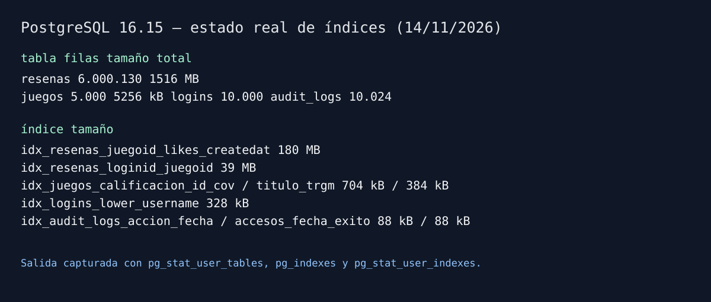
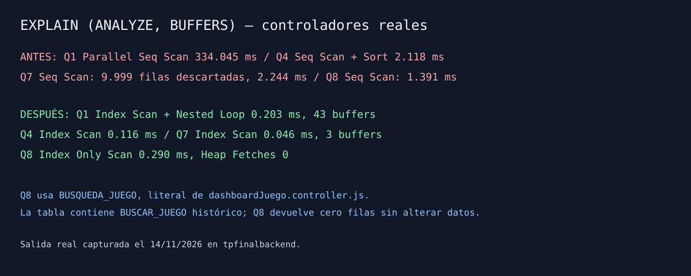

# HU-08 — Optimización y análisis de consultas SQL

## Alcance y método

Se analizaron nueve consultas que corresponden a controladores existentes, sin cambiar endpoints ni modelos. Las mediciones se hicieron en `tpfinalbackend`, PostgreSQL 16.15, el 14/11/2026, sobre 6.000.130 `resenas`, 5.000 `juegos`, 10.000 `logins`, 10.000 `accesos` y 10.024 `audit_logs`.

Cada medición usa `EXPLAIN (ANALYZE, BUFFERS)`. La línea base elimina temporalmente los índices HU-08 dentro de una transacción y finaliza con `ROLLBACK`; no borra datos ni deja cambios. Los scripts son `explain_queries_before.sql`, `measure_baseline_transaction.sql`, `create_indexes.sql` y `explain_queries_after.sql` en `db-scripts/optimizations/`.

## Consultas representativas

| ID | Controlador y operación real | SQL de prueba | Índice / decisión |
|---|---|---|---|
| Q1 | `resena.controller.js`, `getResenasByJuego` | filtro `juegoId`, orden `likes DESC, createdAt DESC`, límite | `resenas(juegoId, likes DESC, createdAt DESC)` |
| Q2 | mismo `findAndCountAll` | `COUNT(*) WHERE juegoId = 42` | reutiliza el prefijo de Q1 |
| Q3 | `createResena` | existencia por `loginId` y `juegoId` | `resenas(loginId, juegoId)` |
| Q4 | `juego.controller.js`, `getMasJugados` | `SELECT * FROM juegos ORDER BY calificacion DESC LIMIT 10` | B-tree de catálogo por calificación |
| Q5 | `getSugerencias` | `SELECT * ... WHERE titulo ILIKE '%Cyber%' ORDER BY calificacion DESC LIMIT 10` | GIN trigram evaluado; el plan real prefirió B-tree ordenado |
| Q6 | `dashboardJuego.controller.js`, `getEstadisticas` | `GROUP BY juegoId ORDER BY COUNT(*) DESC LIMIT 1` | lectura sólo-índice de reseñas, sin índice redundante para agregación global |
| Q7 | `login.controller.js`, `loginUsuario` | `SELECT * FROM logins WHERE username = 'gamer_10000' LIMIT 1` | `logins(username)`; igualdad exacta |
| Q8 | `dashboardJuego.controller.js`, `getEstadisticas` | `COUNT(*) FROM audit_logs WHERE accion = 'BUSQUEDA_JUEGO'` | prefijo `accion` de `audit_logs(accion, fecha DESC)` |
| Q9 | `dashboard.controller.js`, `getLoginsPorDia` | rango de fecha, agrupación `DATE(fecha)` y conteos de `exito` | `accesos(fecha, exito)` |

Q8 usa `BUSQUEDA_JUEGO` porque es el literal real del controlador. El relevamiento mostró datos históricos con `BUSCAR_JUEGO` y ninguno con `BUSQUEDA_JUEGO`; por eso Q8 devuelve cero filas. No se modificaron datos ni se cambió el literal para mejorar artificialmente la prueba. Los SQL de Q8 son idénticos antes y después.

## Planes y mediciones reales

| ID | Antes (ms) | Después (ms) | Plan posterior / evidencia |
|---|---:|---:|---|
| Q1 | 334,045 | 0,203 | Index Scan + Nested Loop; 150.445 → 43 buffers |
| Q2 | 266,308 | 0,451 | Index Only Scan, `Heap Fetches: 0` |
| Q3 | 272,128 | 0,050 | Index Scan; 149.390 → 3 buffers |
| Q4 | 2,118 | 0,116 | Index Scan; desaparece Sort |
| Q5 | 2,718 | 0,472 | Index Scan ordenado con filtro `ILIKE` |
| Q6 | 715,399 | 616,760 | Parallel Index Only Scan; el ranking global sigue recorriendo las entradas necesarias |
| Q7 | 2,244 | 0,046 | Seq Scan con 9.999 filas descartadas → Index Scan |
| Q8 | 1,391 | 0,290 | Seq Scan → Index Only Scan; resultado vacío por el dato histórico descrito |
| Q9 | 2,964 | 0,613 | Index Only Scan; 151 → 4 buffers |

## Justificación e impacto

- `idx_resenas_juegoid_likes_createdat`: resuelve Q1 en el orden solicitado y Q2 por su prefijo izquierdo; evita un índice simple duplicado. Ocupa 180 MB. Cada inserción y actualización de `likes` debe mantenerlo, y esa actualización puede impedir HOT updates.
- `idx_resenas_loginid_juegoid`: es selectivo para Q3 y ocupa 39 MB; se mantiene en cada alta de reseña.
- `idx_juegos_calificacion_id_cov`: conserva el orden de Q4 y acelera Q5 cuando el optimizador prioriza orden/límite. Q4 selecciona todas las columnas, de modo que el plan correcto es `Index Scan`, no se afirma falsamente `Index Only Scan`.
- `idx_juegos_titulo_trgm`: habilita una alternativa para `ILIKE '%texto%'`, no SARGable con B-tree. En esta muestra Q5 no lo eligió PostgreSQL: con 5.000 filas y `LIMIT 10` resultó mejor el índice ordenado. Ocupa 384 kB.
- `idx_logins_username`: optimiza la igualdad exacta de Q7 y no es único para no imponer una regla funcional nueva. `idx_logins_lower_username` se incorpora como índice UNIQUE funcional para garantizar la unicidad de los nombres de usuario sin distinción de mayúsculas y minúsculas. La comprobación previa con `GROUP BY lower(username) HAVING count(*) > 1` no detectó duplicados. Este índice cumple una función de integridad y no se atribuye a la mejora de Q7.
- `idx_audit_logs_accion_fecha`: el prefijo sirve a Q8 y la fecha descendente sirve listados por acción ordenados cronológicamente. Ocupa 88 kB.
- `idx_accesos_fecha_exito`: acota Q9 por fecha y cubre el indicador `exito`; ocupa 88 kB.

Se ejecuta `ANALYZE` tras el DDL. `pg_stats` reportó aproximadamente 4.992 valores distintos para `resenas.juegoId`, 10.061 para `loginId`, 51 para `juegos.calificacion` y seis acciones históricas. Esto explica la selectividad de Q1-Q3 y por qué Q6 debe leer todas las entradas para el ranking global.

## Configuración, validaciones y cumplimiento

Se revisaron los parámetros de configuración persistentes de PostgreSQL sin modificar sus valores: `shared_buffers=128MB`, `effective_cache_size=4GB`, `maintenance_work_mem=64MB`, `work_mem=4MB`, `random_page_cost=4` y `default_statistics_target=100`. El script `create_indexes.sql` establece temporalmente `maintenance_work_mem=256MB` durante su ejecución para optimizar la creación de índices, sin alterar la configuración persistente del servidor. Docker sólo monta `create_indexes.sql` para la inicialización; no ejecuta mediciones ni agrega configuración de memoria.

- `docker compose config --quiet`: correcto.
- PostgreSQL, backend y frontend: saludables.
- `GET /resenas/juego/42?pagina=1&limite=10` y `GET /juego/sugerencias/Cyber`: HTTP 200.
- Se confirmaron índices posteriores y el `ROLLBACK` de la comparación.

| Exigencia oficial | Evidencia |
|---|---|
| Consultas frecuentes/costosas y mínimo ocho | Q1–Q9 y scripts SQL |
| EXPLAIN ANALYZE, buffers, scans y joins | tabla de planes y scripts |
| Índices, cardinalidad, selectividad y estadísticas | justificación e `pg_stats` |
| Índices compuestos, cobertura, funcionales y trigram | `create_indexes.sql` |
| Consultas no SARGables | Q5; `LOWER` sólo se conserva por integridad |
| Antes/después real y decisiones | tabla de mediciones y transacción reversible |
| Parámetros y entregables | esta sección, scripts e imágenes en `docs/images/hu08/` |

## Conclusión

Las mejoras principales eliminan scans de millones de reseñas. Q6 mejora de manera moderada porque el máximo global requiere leer las entradas; si ganara frecuencia, corresponde evaluar una vista materializada o agregado persistido, no crear índices adicionales sin evidencia.
