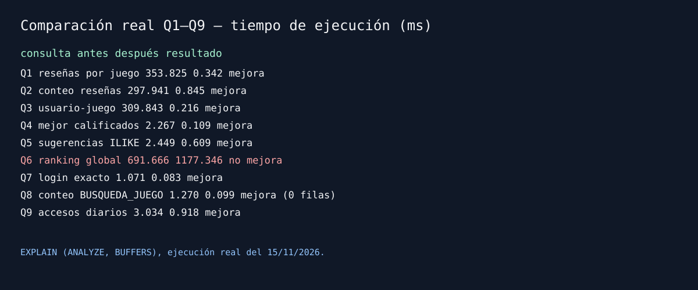

# HU-08 — Optimización y análisis de consultas SQL

## Objetivo, entorno y método

Se relevaron y midieron nueve consultas reales del backend con `EXPLAIN (ANALYZE, BUFFERS)` el 15/11/2026 sobre PostgreSQL 16.15 (`gamer_postgres`, base `tpfinalbackend`). La línea base se obtuvo ejecutando `measure_baseline_transaction.sql`: abre una transacción, elimina temporalmente los ocho índices HU-08, ejecuta Q1–Q9 y finaliza con `ROLLBACK`. No se eliminaron volúmenes, registros ni índices persistentes.

Estado real de tablas:

| Tabla | Filas vivas | Tamaño total |
|---|---:|---:|
| `resenas` | 6.000.000 | 1595 MB |
| `juegos` | 5.000 | 5336 kB |
| `logins` | 10.000 | 3544 kB |
| `Usuarios` | 10.000 | 1024 kB |
| `accesos` | 10.000 | 1816 kB |
| `audit_logs` | 10.003 | 2456 kB |

## Consultas relevadas

| ID | Origen real | Consulta / propósito | Índice relacionado |
|---|---|---|---|
| Q1 | `resena.controller.js`, `getResenasByJuego` | reseñas de un juego ordenadas por likes y fecha | `(juegoId, likes DESC, createdAt DESC)` |
| Q2 | mismo `findAndCountAll` | `COUNT(*)` de reseñas del juego | prefijo de Q1 |
| Q3 | `createResena` | existencia por `loginId` y `juegoId` | `(loginId, juegoId)` |
| Q4 | `juego.controller.js`, `getMasJugados` | `SELECT *` ordenado por calificación, límite 10 | `(calificacion DESC, id) INCLUDE (...)` |
| Q5 | `getSugerencias` | `ILIKE '%Cyber%'`, orden por calificación, límite 10 | GIN trigram evaluado; B-tree ordenado elegido |
| Q6 | `dashboardJuego.controller.js`, `getEstadisticas` | juego con más reseñas: `GROUP BY juegoId` | lectura de índices de reseñas |
| Q7 | `login.controller.js`, `loginUsuario` | igualdad exacta de `username` | `logins(username)` |
| Q8 | `dashboardJuego.controller.js`, `getEstadisticas` | conteo de `BUSQUEDA_JUEGO` | prefijo de `(accion, fecha DESC)` |
| Q9 | `dashboard.controller.js`, `getLoginsPorDia` | rango temporal, `DATE(fecha)` y conteos de éxito | `(fecha, exito)` |

Q8 conserva el literal real del controlador, `BUSQUEDA_JUEGO`. La tabla contiene acciones históricas distintas y la consulta devolvió cero filas; no se alteraron registros para cambiar ese resultado.

## Planes y mediciones actuales

Se comparó el tiempo total de ejecución informado por PostgreSQL y la cantidad total de buffers compartidos (`shared hit + shared read`) de cada plan.

| ID | Antes (ms) | Después (ms) | Antes: plan / buffers | Después: plan / buffers |
|---|---:|---:|---|---|
| Q1 | 379,526 | 0,312 | Parallel Seq Scan + Hash Left Join + Sort; 149.294 | Index Scan + Nested Loop Left Join; 43 |
| Q2 | 304,085 | 0,474 | Parallel Seq Scan; 148.248 | Index Only Scan, 0 heap fetches; 963 |
| Q3 | 395,334 | 0,057 | Parallel Seq Scan; 148.248 | Index Scan; 3 |
| Q4 | 2,541 | 0,097 | Seq Scan + top-N Sort; 500 | Index Scan; 11 |
| Q5 | 2,451 | 0,590 | Seq Scan + top-N Sort; 500 | Index Scan con filtro `ILIKE`; 209 |
| Q6 | 747,094 | 1274,219 | Parallel Seq Scan; 148.265 | Parallel Index Only Scan, 0 heap fetches; 4.765.701 |
| Q7 | 1,110 | 0,098 | Seq Scan, 9.999 filas descartadas; 300 | Index Scan; 3 |
| Q8 | 1,260 | 0,081 | Seq Scan, cero filas; 216 | Index Only Scan, 0 heap fetches; 2 |
| Q9 | 3,173 | 1,013 | Seq Scan + Sort + GroupAggregate; 154 | Index Only Scan + Sort + GroupAggregate; 11 |

Los tiempos corresponden a ejecuciones reales de la instancia y pueden variar según el estado de la caché y la carga del servidor. Q1–Q5 y Q7–Q9 mejoraron; Q6 fue la única consulta que empeoró en esta ejecución.

### Análisis de los resultados

- **Q1:** pasó de un `Parallel Seq Scan` sobre `resenas`, seguido de un `Hash Left Join` y un ordenamiento, a un `Index Scan` mediante `idx_resenas_juegoid_likes_createdat`. El plan posterior utiliza un `Nested Loop Left Join` y obtiene directamente las reseñas del juego en el orden requerido.
- **Q2:** reemplazó el recorrido secuencial por un `Index Only Scan` sobre `idx_resenas_juegoid_likes_createdat`, sin accesos adicionales al heap (`Heap Fetches: 0`).
- **Q3:** pasó de recorrer paralelamente toda la tabla `resenas` a utilizar `idx_resenas_loginid_juegoid`, resolviendo la búsqueda mediante las dos columnas del índice.
- **Q4:** reemplazó el recorrido completo de `juegos` y el ordenamiento posterior por un `Index Scan` sobre `idx_juegos_calificacion_id_cov`.
- **Q5:** redujo el tiempo de ejecución y utilizó `idx_juegos_calificacion_id_cov` para recorrer los juegos ordenados por calificación. La condición `ILIKE '%Cyber%'` permaneció como filtro; el índice GIN de trigramas no fue seleccionado por el planificador en esta ejecución.
- **Q6:** fue la única consulta que empeoró: pasó de 747,094 ms a 1274,219 ms. El plan posterior utilizó un `Parallel Index Only Scan` sobre `idx_resenas_loginid_juegoid`, con cero accesos al heap. Sin embargo, tuvo que recorrer los seis millones de registros para realizar la agregación global. El recorrido generó 4.765.701 buffers compartidos, frente a 148.265 en la línea base. Por lo tanto, el uso del índice no representó una optimización efectiva para esta consulta.
- **Q7:** reemplazó el `Seq Scan` de la tabla `logins` por un `Index Scan` sobre `idx_logins_username`.
- **Q8:** utilizó un `Index Only Scan` sobre `idx_audit_logs_accion_fecha`, evitando recorrer toda la tabla de auditoría. La consulta no encontró registros coincidentes con `BUSQUEDA_JUEGO`, tanto antes como después de la optimización.
- **Q9:** reemplazó el recorrido secuencial de `accesos` por un `Index Only Scan` sobre `idx_accesos_fecha_exito`, reduciendo los bloques consultados.

## Índices, selectividad y costos

Los ocho índices HU-08 siguen presentes:

| Índice | Tamaño actual | Justificación |
|---|---:|---|
| `idx_resenas_juegoid_likes_createdat` | 180 MB | Q1 elimina el sort y Q2 aprovecha el prefijo `juegoId`; evita un B-tree simple redundante. |
| `idx_resenas_loginid_juegoid` | 127 MB | Q3 resuelve el par usuario-juego de forma selectiva. |
| `idx_juegos_calificacion_id_cov` | 752 kB | Q4 respeta orden y límite; también resulta elegido en Q5. |
| `idx_juegos_titulo_trgm` | 416 kB | alternativa para subcadenas `ILIKE`; el optimizador no lo eligió en esta muestra. |
| `idx_logins_lower_username` | 328 kB | integridad sin distinción entre mayúsculas/minúsculas; no se atribuye a Q7. |
| `idx_logins_username` | 328 kB | Q7 usa igualdad exacta. |
| `idx_audit_logs_accion_fecha` | 432 kB | Q8 usa su prefijo `accion`; fecha sirve para listados por acción. |
| `idx_accesos_fecha_exito` | 328 kB | Q9 filtra fecha y consulta `exito`. |

Cada índice suma almacenamiento y trabajo a inserciones y actualizaciones. Los dos de `resenas` son los más costosos: una inserción mantiene ambos y actualizar `likes` puede impedir HOT updates porque `likes` participa en la clave de Q1. No se añadió un índice adicional para Q6: la medición confirma que un ranking global requiere una solución de agregación (por ejemplo, vista materializada) si su frecuencia lo justifica, no otro índice sin evidencia.

Las estadísticas actuales reflejan: `resenas.juegoId` 4.999 valores distintos, `resenas.loginId` 10.044, `juegos.calificacion` 51, `audit_logs.accion` 5 y `accesos.fecha` con cardinalidad estimada `-1`; todas sin nulos. Se ejecuta `ANALYZE` después de crear los índices.

## Configuración, validaciones y cumplimiento

Parámetros observados: `shared_buffers=128MB`, `effective_cache_size=4GB`, `maintenance_work_mem=64MB`, `work_mem=4MB`, `random_page_cost=4` y `default_statistics_target=100`. No se modificó esta configuración.

- PostgreSQL, backend y frontend estaban saludables en Docker Compose.
- Q1–Q9 se ejecutaron antes y después con `EXPLAIN (ANALYZE, BUFFERS)`.
- Se comprobó el `ROLLBACK` de la línea base y la presencia posterior de los ocho índices HU-08.
- Se conservaron la funcionalidad y los datos de los endpoints.

| Exigencia | Evidencia |
|---|---|
| Consultas frecuentes/costosas; mínimo ocho | Q1–Q9 y scripts SQL existentes |
| Planes, buffers y comparación real | tabla de mediciones e imágenes |
| Índices, selectividad, cardinalidad y estadísticas | tablas de índices/estadísticas y explicación |
| Consultas no SARGables | Q5 y evaluación de `pg_trgm` |
| Efecto de escritura/almacenamiento | sección Índices, selectividad y costos |
| Parámetros de PostgreSQL | sección Configuración |
| Entregables | scripts existentes, este informe y SVG en `docs/images/hu08/` |

## Conclusión

El nuevo dataset conserva la alta selectividad de las consultas puntuales sobre reseñas: Q1–Q3 dejan de recorrer los seis millones de registros y pasan a utilizar índices específicos. Las mediciones también muestran el límite de esta estrategia: Q6 no mejora con el índice elegido para la agregación global. De hecho, el recorrido completo del índice produjo un volumen mucho mayor de accesos a buffers y un tiempo de ejecución superior al de la línea base.

Esta evidencia permite justificar los índices que mejoran las consultas selectivas y, al mismo tiempo, descartar la incorporación de índices adicionales para Q6 sin un rediseño de la consulta o una estrategia de agregación precalculada. La optimización debe evaluarse según el patrón de acceso real de cada consulta y no únicamente por la presencia de índices.