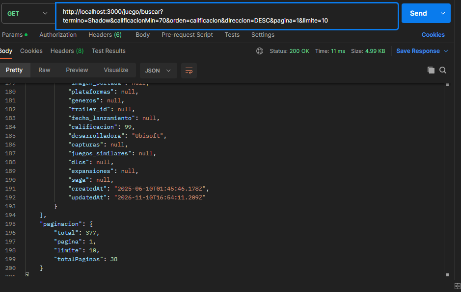
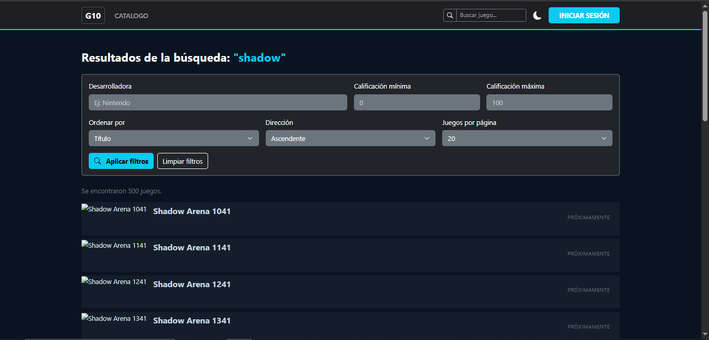

# Historia de Usuario 21 (HU-21): Integración Full-Stack con PostgreSQL y Consultas Críticas

## 1. Descripción

Como desarrollador full-stack, quiero conectar el proyecto con la base de datos y actualizar el frontend y backend para utilizar las consultas críticas.

Establecer la conexión persistente entre el servidor y PostgreSQL, configurar los endpoints necesarios para las búsquedas y filtros avanzados, y desarrollar las vistas del frontend que permitan ejecutar las consultas optimizadas de la HU-08.

Además, integrar la consulta y visualización de reseñas asociadas a cada juego, permitiendo recuperar los registros de manera paginada.

---

## 2. Implementación

### A. Conexión con PostgreSQL

Se configuró la conexión entre el backend y PostgreSQL mediante Sequelize, utilizando las variables de entorno definidas para la conexión a la base de datos.

Además, se configuró Docker Compose para coordinar el inicio de los servicios, utilizando un `healthcheck` en PostgreSQL. De esta manera, el backend puede esperar a que la base de datos se encuentre disponible antes de iniciar su funcionamiento.

La conexión permite que el servidor consulte los datos almacenados en PostgreSQL y que las operaciones del sistema utilicen la base de datos local.

### B. Implementación de endpoints para juegos

Se actualizaron los controladores y rutas correspondientes a los juegos para que las consultas se realicen sobre los registros almacenados en PostgreSQL, eliminando la dependencia de IGDB como fuente de datos del catálogo.

Se implementaron y adaptaron los siguientes endpoints:

| Endpoint | Funcionalidad |
|---|---|
| `GET /juego/` | Obtiene el catálogo de juegos almacenados en la base de datos. |
| `GET /juego/mas-jugados` | Obtiene los juegos con mayor calificación. |
| `GET /juego/buscar` | Permite realizar búsquedas con filtros avanzados, ordenamiento y paginación. |
| `GET /juego/sugerencias/:nombre` | Busca sugerencias de juegos por título. |
| `GET /juego/detalle/:id` | Obtiene el detalle de un juego a partir de su identificador. |

Para la búsqueda avanzada se incorporaron filtros por título, desarrolladora y rango de calificación. También se permite ordenar los resultados por distintos campos, seleccionar la dirección del ordenamiento y navegar los resultados mediante paginación.

Se utilizaron operadores de Sequelize para construir las consultas, evitando tener que recuperar todo el catálogo para realizar cada búsqueda.

### C. Integración del frontend para juegos

Se actualizaron las pantallas y componentes del frontend para consumir los endpoints del backend y utilizar los datos almacenados en PostgreSQL.

Los principales cambios fueron:

- **Home:** se conectaron las secciones del catálogo con los endpoints del backend para mostrar juegos provenientes de la base de datos.
- **Resultados:** se integró la búsqueda avanzada con los filtros, el ordenamiento y la paginación.
- **Navbar:** se conectó el buscador de sugerencias con el endpoint correspondiente.
- **Detalle de juego:** se unificaron las rutas de navegación y se conectó la vista con el endpoint que obtiene los datos de un juego por su ID.
- **Imágenes:** se incorporó una imagen de reemplazo para los juegos que no tienen una portada disponible.

También se unificó la navegación hacia los detalles utilizando la ruta `/juego/:id`.

### D. Integración y paginación de reseñas

Se incorporó la consulta de reseñas asociadas a cada juego para que puedan visualizarse desde su pantalla de detalle.

En el backend se implementó el endpoint:

`GET /resenas/juego/:juegoId`

Este endpoint permite consultar las reseñas correspondientes a un juego específico y admite los siguientes parámetros:

| Parámetro | Descripción |
|---|---|
| `pagina` | Número de página que se desea consultar. |
| `limite` | Cantidad de reseñas por página, con un máximo de 50. |

Para recuperar los registros se utilizó `findAndCountAll()` de Sequelize, obteniendo las reseñas y el total de resultados correspondientes al juego consultado.

La respuesta incluye los datos de cada reseña, información del usuario asociado (ID, username, nombre y foto), cantidad total de reseñas, página actual, límite y cantidad total de páginas.

Los resultados se ordenan por cantidad de likes de mayor a menor y, en caso de igualdad, por fecha de creación más reciente.

En el frontend se realizaron los siguientes cambios:

- Se agregó el método `obtenerResenas()` en `juegos.service.ts` para consumir el endpoint y enviar los parámetros de paginación.
- Se incorporaron en el componente `juego-detalle.ts` las propiedades necesarias para almacenar las reseñas, controlar la carga, gestionar errores y mantener el estado de la paginación.
- Al cargar el detalle de un juego, se consulta también su listado de reseñas.
- Se actualizó `juego-detalle.html` para mostrar las reseñas con el nombre o username del usuario, su foto cuando está disponible, la fecha, el texto y la cantidad de likes.
- Se incorporaron controles para navegar entre páginas de reseñas.

---

## 3. Pruebas realizadas

Se verificó el funcionamiento de la integración mediante consultas a los endpoints del backend y pruebas desde la interfaz del frontend.

Las pruebas incluyeron:

1. Obtener el catálogo completo de juegos almacenados en PostgreSQL.
2. Consultar los juegos con mayor calificación.
3. Buscar juegos mediante el título y comprobar las sugerencias.
4. Ejecutar búsquedas con filtros avanzados.
5. Comprobar el funcionamiento del ordenamiento y la paginación.
6. Consultar el detalle de un juego mediante su ID.
7. Verificar el comportamiento ante identificadores inexistentes.
8. Comprobar la navegación desde el Home, el buscador y la pantalla de resultados hacia el detalle de cada juego.
9. Consultar las reseñas de un juego mediante el endpoint `/resenas/juego/:juegoId`.
10. Verificar la respuesta paginada mediante los parámetros `pagina` y `limite`.
11. Comprobar que las reseñas correspondan al juego solicitado y que incluyan la información del usuario asociado.
12. Verificar la visualización de las reseñas y la navegación entre páginas desde el detalle del juego.

Se comprobó que las consultas del catálogo y las búsquedas utilizan los registros de la base de datos local, y que las reseñas se recuperan desde PostgreSQL a través del backend.

### Evidencia de las pruebas

**Consulta paginada de reseñas mediante Postman**

**Búsqueda avanzada de juegos desde el frontend**

---

## 4. Criterios de aceptación

- [x] Conexión full-stack a la base de datos establecida.
- [x] Endpoints de filtrado y consultas masivas implementados.
- [x] Pantalla de búsqueda en el frontend conectada y operativa.
- [x] Consulta de reseñas asociadas a cada juego implementada.
- [x] Paginación de reseñas incorporada en el backend.
- [x] Visualización de reseñas y navegación entre páginas integrada en el frontend.

---

## 5. Resultado

La historia de usuario quedó implementada. El frontend y el backend se encuentran integrados con PostgreSQL, permitiendo consultar el catálogo local, realizar búsquedas con filtros avanzados y acceder al detalle de los juegos desde la interfaz.

Además, se incorporó la consulta paginada de reseñas por juego y su visualización en la pantalla de detalle, incluyendo la información de los usuarios asociados.

La integración permite recuperar y filtrar los datos almacenados en la base de datos local sin depender de una API externa para obtener la información del catálogo.