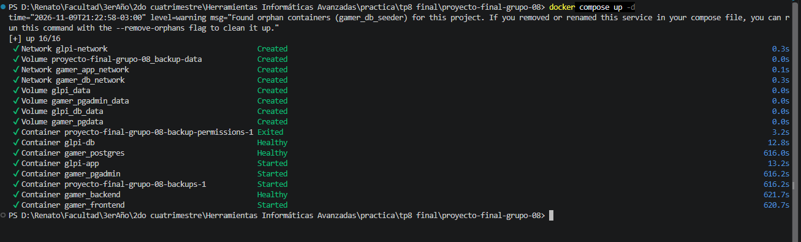

Historia de Usuario 22 (HU-22): Inicialización Nativa de PostgreSQL mediante Docker
1. Descripción General
- ID: HU-22
- Título: Automatizar la inicialización del esquema de la base de datos mediante scripts SQL independientes del backend.
- Sprint: Sprint 2 (Fase 2).
- Objetivo: Automatizar la creación del esquema relacional y la carga inicial de datos utilizando el mecanismo nativo de inicialización de la imagen oficial de PostgreSQL, eliminando la creación automática de tablas desde Sequelize y evitando la necesidad de un contenedor auxiliar para ejecutar los scripts SQL.
La solución busca que, al iniciar el proyecto con Docker Compose y utilizando un volumen de PostgreSQL vacío, la propia instancia de PostgreSQL cree las tablas y cargue los datos iniciales antes de que el backend comience a operar.
2. Criterios de Aceptación
1. [x] Eliminar la sincronización automática del esquema mediante sequelize.sync({ alter: true }).
2. [x] Mantener Sequelize como herramienta de conexión y acceso a la base de datos, sin utilizarlo para modificar automáticamente la estructura.
3. [x] Configurar la inicialización nativa de PostgreSQL mediante el directorio /docker-entrypoint-initdb.d/.
4. [x] Ejecutar primero el DDL (01_schema_init.sql) y luego el script de carga masiva (02_massive_seed_6M.sql).
5. [x] Evitar la creación de un servicio o contenedor auxiliar para ejecutar los scripts.
6. [x] Configurar el healthcheck de PostgreSQL para que los servicios dependientes esperen a que la inicialización haya finalizado.
7. [x] Hacer que el backend verifique la conexión con PostgreSQL antes de comenzar a escuchar peticiones.
8. [x] Validar el procedimiento desde un volumen de datos vacío y comprobar la creación de las tablas y la carga de los registros.
3. Evidencia Técnica e Implementación
A. Separación entre conexión y creación del esquema
Anteriormente, el backend utilizaba sequelize.sync({ alter: true }) para sincronizar los modelos de Sequelize con las tablas de PostgreSQL. Esta modalidad permite que Sequelize intente crear o modificar tablas automáticamente al iniciar la aplicación.

Para esta historia de usuario se eliminó ese mecanismo. El archivo backend/config/database.js ahora se limita a configurar y exportar la instancia de Sequelize.

En backend/index.js, antes de iniciar el servidor HTTP, se ejecuta sequelize.authenticate(). Esta operación comprueba que el backend puede conectarse a la base de datos, pero no crea ni modifica tablas.

Si la conexión es correcta, el backend inicia el servidor. Si falla, muestra el error y termina el proceso con un código de salida distinto de cero.

Esta separación deja dos responsabilidades claras:
- PostgreSQL y los scripts SQL: crean la estructura y cargan los datos iniciales.
- Sequelize: permite que el backend se conecte y trabaje con las tablas existentes.
B. Inicialización nativa mediante la imagen oficial de PostgreSQL
Se configuró el servicio postgres de docker-compose.yml para montar directamente los scripts SQL dentro del directorio especial:

/docker-entrypoint-initdb.d/

Los archivos se montan de forma individual y en modo de solo lectura:
- db-scripts/init/01_schema_init.sql → /docker-entrypoint-initdb.d/01_schema_init.sql
- db-scripts/seeders/02_massive_seed_6M.sql → /docker-entrypoint-initdb.d/02_massive_seed_6M.sql
La imagen oficial de PostgreSQL incluye un proceso de inicialización en su punto de entrada. Cuando detecta que el directorio de datos está vacío, inicializa el motor y ejecuta los archivos compatibles que encuentra en /docker-entrypoint-initdb.d/.

Los nombres de los archivos permiten establecer el orden alfabético de ejecución: primero 01_schema_init.sql y después 02_massive_seed_6M.sql.

Por lo tanto, el segundo script encuentra las tablas creadas por el primero y puede insertar los registros respetando las relaciones y restricciones definidas.

Importante: este mecanismo se ejecuta durante la inicialización de un directorio de datos vacío. No vuelve a ejecutar los scripts cada vez que se reinicia un contenedor si el volumen ya contiene una base inicializada. Para probar nuevamente una inicialización desde cero, es necesario eliminar el volumen de PostgreSQL y volver a levantar el proyecto. Esto elimina los datos persistidos en ese volumen.
C. Creación del esquema mediante DDL
El archivo 01_schema_init.sql contiene las instrucciones CREATE TABLE necesarias para crear las seis tablas utilizadas por el sistema:
- logins
- "Usuarios"
- juegos
- resenas
- accesos
- audit_logs
El esquema define las claves primarias, los tipos de datos, los campos obligatorios, los valores predeterminados y las relaciones mediante claves foráneas.

También se respetan los nombres de columnas sensibles a mayúsculas y minúsculas que utiliza Sequelize, como "createdAt", "updatedAt", "loginId" y "juegoId". En PostgreSQL, los identificadores escritos entre comillas dobles conservan exactamente su capitalización.

La tabla "Usuarios" conserva su nombre con mayúscula inicial, correspondiente a la pluralización que utiliza el modelo Usuario en el proyecto. Su campo "loginId" es único y referencia a logins(id), reflejando la relación uno a uno configurada entre ambos modelos.

Las relaciones de las reseñas también quedan definidas mediante claves foráneas:
- resenas."juegoId" referencia a juegos(id).
- resenas."loginId" referencia a logins(id).
Las restricciones ON DELETE CASCADE hacen que, al eliminar un registro referenciado, PostgreSQL elimine también los registros dependientes correspondientes.

El script no contiene instrucciones DROP TABLE: la creación está pensada para una base nueva, no para borrar y reconstruir tablas en una base persistente.
D. Carga masiva de datos
El archivo 02_massive_seed_6M.sql genera datos de prueba utilizando generate_series() e instrucciones INSERT INTO ... SELECT.

En lugar de enviar millones de inserciones individuales desde una aplicación, PostgreSQL genera e inserta los registros directamente mediante operaciones orientadas a conjuntos.

La distribución de los datos es la siguiente:
Tabla	Registros insertados
juegos	5.000
logins	100.000
"Usuarios"	100.000
resenas	5.800.000
accesos	50.000
audit_logs	45.000
Total	6.100.000

El archivo utiliza funciones y expresiones de PostgreSQL para generar títulos, nombres, apellidos, correos, fechas, calificaciones, accesos y registros de auditoría simulados.

También aplica dos ajustes durante la carga:
- maintenance_work_mem = '512MB': establece el límite de memoria de trabajo para determinadas operaciones de mantenimiento que pueden utilizarla.
- synchronous_commit = OFF: reduce la espera por la confirmación de escritura en disco de cada transacción de la sesión durante la carga. Se vuelve a establecer en ON al finalizar el script.
Finalmente, se ejecuta ANALYZE sobre las seis tablas. Esto actualiza estadísticas que el optimizador de PostgreSQL utiliza para estimar costos y elegir planes de ejecución de consultas.

Tiempo registrado para la inicialización y carga de PostgreSQL: 616 segundos (10 minutos y 16 segundos).
E. Orden de arranque y comprobación de disponibilidad
El servicio postgres cuenta con un healthcheck basado en pg_isready. La comprobación se realiza contra 127.0.0.1 para verificar que PostgreSQL acepta conexiones TCP, en lugar de detectar únicamente el servidor temporal que puede utilizarse durante la inicialización.

Se configuró un período de inicio amplio (start_period: 15m) para contemplar el tiempo que puede requerir la carga masiva antes de que Docker considere fallidos los controles de salud.

Los servicios que necesitan la base de datos utilizan la dependencia service_healthy. De esta manera, Docker Compose espera a que PostgreSQL figure como saludable antes de iniciar esos servicios.

Además, el backend ejecuta sequelize.authenticate() antes de llamar a app.listen(). Así se comprueba la conexión efectiva desde la aplicación antes de aceptar peticiones.
F. Validación realizada
La prueba se realizó eliminando previamente los volúmenes persistentes del entorno y levantando nuevamente el proyecto con Docker Compose.

Durante la ejecución se verificó que:
1. PostgreSQL inicializara el directorio de datos.
2. Se ejecutara 01_schema_init.sql y se crearan las seis tablas.
3. Se ejecutara 02_massive_seed_6M.sql y se completara la carga masiva.
4. PostgreSQL y el backend alcanzaran el estado healthy.
5. Las tablas contuvieran las cantidades de registros esperadas.
La inicialización se realizó utilizando el servicio PostgreSQL existente en el Compose, sin agregar un contenedor auxiliar o servicio db-seeder.

Como evidencia visual se incorpora una única captura de la salida de docker compose ps, donde se observa el estado de los contenedores levantados y la disponibilidad de los servicios.

> 

4. Consideraciones Técnicas
¿Por qué los scripts no se ejecutan en cada reinicio?
PostgreSQL guarda sus datos en el volumen montado en /var/lib/postgresql/data. La imagen oficial detecta si ese directorio ya fue inicializado. Si encuentra una base existente, no vuelve a ejecutar los scripts de /docker-entrypoint-initdb.d/.

Esto evita que cada reinicio intente volver a crear tablas o insertar nuevamente millones de registros.
¿Qué sucede si falla un script durante la inicialización?
Los scripts de inicialización no deben considerarse un mecanismo de migraciones recurrentes. Si una inicialización desde cero falla a mitad de camino, no conviene limitarse a reiniciar el contenedor esperando que el proceso continúe desde donde quedó: el directorio de datos puede haber quedado parcialmente inicializado y los scripts no necesariamente se volverán a ejecutar.

Para repetir una prueba de inicialización desde cero, primero hay que detener el entorno y eliminar el volumen correspondiente, teniendo presente que esto borra los datos almacenados. Luego se puede levantar nuevamente el proyecto.
¿Por qué se mantiene sequelize.authenticate()?
Eliminar sequelize.sync() no significa eliminar Sequelize. El backend sigue necesitando conectarse a PostgreSQL para ejecutar sus consultas y utilizar sus modelos. authenticate() verifica esa conexión sin asumir la responsabilidad de crear o alterar el esquema.
5. Conclusión
La HU-22 permitió trasladar la responsabilidad de creación del esquema y carga inicial de datos desde el backend hacia el mecanismo nativo de inicialización de la imagen oficial de PostgreSQL.

La solución ejecuta el DDL y el seeder en el orden esperado, aprovecha el volumen persistente para evitar repetir la carga en cada reinicio y coordina el arranque de los servicios mediante controles de salud.

La validación desde un volumen limpio confirmó la creación de las seis tablas y la inserción de 6.100.000 registros. La inicialización se realizó utilizando el servicio PostgreSQL existente, sin necesidad de incorporar un contenedor auxiliar para la carga.

De esta manera, el entorno queda preparado para levantar el proyecto mediante Docker Compose con una base de datos inicializada y disponible para el backend.