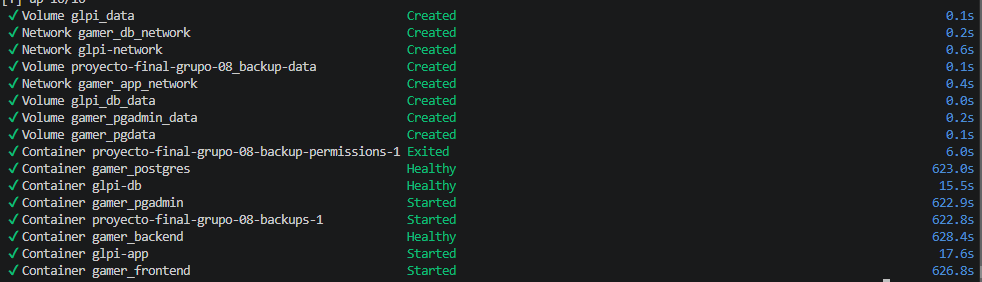

# Historia de Usuario 22 (HU-22): Automatización de la Inicialización de PostgreSQL mediante Docker

## 1. Descripción General

- **ID:** HU-22
- **Título:** Automatización de la inicialización de la base de datos PostgreSQL.
- **Objetivo:** Automatizar la creación del esquema relacional y la carga inicial de datos de PostgreSQL mediante los mecanismos nativos de Docker, evitando la ejecución manual de scripts y asegurando que los servicios dependientes se inicien cuando la base de datos esté disponible.

---

## 2. Implementación

### A. Inicialización automática mediante PostgreSQL

Se configuró el contenedor de PostgreSQL para ejecutar automáticamente los scripts SQL durante la primera inicialización de un volumen de datos vacío.

Para ello, los archivos se montaron en el directorio nativo `/docker-entrypoint-initdb.d/`:

1. `01_schema_init.sql`: crea la estructura relacional de la base de datos.
2. `02_massive_seed_6M.sql`: realiza la carga inicial de datos de prueba.

PostgreSQL ejecuta los scripts de ese directorio durante la inicialización del directorio de datos, respetando el orden alfabético de sus nombres.

Los archivos se incorporaron mediante volúmenes de Docker, sin necesidad de ejecutar manualmente las consultas desde pgAdmin.

Es importante destacar que este mecanismo se ejecuta cuando el directorio de datos de PostgreSQL está vacío. Si el volumen ya contiene una base de datos inicializada, los scripts no vuelven a ejecutarse automáticamente en cada arranque.

### B. Coordinación de servicios mediante Docker Compose

Se configuró Docker Compose para coordinar el inicio de PostgreSQL y los servicios que dependen de la base de datos.

Se incorporó un `healthcheck` basado en `pg_isready`, que permite comprobar si PostgreSQL está disponible para aceptar conexiones.

También se configuró un período de inicio (`start_period`) de 15 minutos para contemplar el tiempo requerido por la inicialización y la carga masiva de datos.

Los servicios dependientes utilizan la condición `service_healthy` en `depends_on`, evitando que intenten conectarse a PostgreSQL antes de que se encuentre disponible.

De esta manera, Docker Compose administra el orden de inicio y la disponibilidad de los servicios sin depender únicamente del tiempo transcurrido desde que se inicia el contenedor.

### C. Integración con Sequelize

Se modificó la inicialización del backend para evitar que Sequelize intente crear o alterar automáticamente la estructura de la base de datos.

Se eliminó el uso de `sequelize.sync({ alter: true })` como mecanismo de creación de tablas.

En su lugar, se utiliza `sequelize.authenticate()` para comprobar que la conexión con PostgreSQL se encuentre disponible antes de iniciar el servidor Express.

Sequelize continúa utilizándose para ejecutar consultas y operaciones sobre los modelos del sistema, mientras que la definición de la estructura de la base de datos queda a cargo de los scripts SQL.

### D. Verificación de la inicialización

Se realizó una inicialización de prueba utilizando un volumen de datos vacío para comprobar que PostgreSQL ejecutara los scripts automáticamente y que los servicios dependientes pudieran iniciar correctamente.

Una vez finalizada la inicialización, se verificó la disponibilidad de los contenedores y la presencia de los registros en las tablas correspondientes.

La carga inicial contempla las siguientes cantidades:

| Tabla | Registros |
|---|---:|
| juegos | 5.000 |
| logins | 10.000 |
| Usuarios | 10.000 |
| resenas | 6.000.000 |
| accesos | 10.000 |
| audit_logs | 10.000 |
| **Total** | **6.045.000** |

### E. Métricas de inicialización

Durante la prueba de inicialización completa mediante Docker Compose se registró un tiempo aproximado de:

- **Tiempo total observado:** 622,9 segundos (10 minutos y 23 segundos).

Esta medición corresponde al proceso de inicialización de PostgreSQL y al arranque de los servicios dependientes. Por lo tanto, no representa exclusivamente el tiempo de ejecución de los scripts SQL.

---

## 3. Criterios de aceptación

- [x] Scripts SQL integrados al mecanismo nativo de inicialización de PostgreSQL.
- [x] Ejecución automática de los scripts durante la primera inicialización de un volumen vacío.
- [x] Configuración del `healthcheck` de PostgreSQL.
- [x] Coordinación del inicio de los servicios dependientes mediante Docker Compose.
- [x] Validación de la conexión del backend mediante Sequelize.
- [x] Verificación de la inicialización y disponibilidad de los servicios.

---

## 4. Resultado

La historia de usuario quedó implementada. La inicialización de PostgreSQL se encuentra automatizada mediante los mecanismos nativos de Docker, permitiendo crear el esquema relacional y cargar los datos iniciales sin intervención manual.

La configuración del `healthcheck` y de las dependencias entre servicios permite coordinar el inicio de la aplicación, mientras que Sequelize verifica la disponibilidad de la conexión antes de iniciar el backend.

De esta manera, el entorno puede reproducir la inicialización completa de la base de datos a partir de un volumen vacío, manteniendo separadas las responsabilidades de definición del esquema, carga de datos y ejecución de la aplicación.