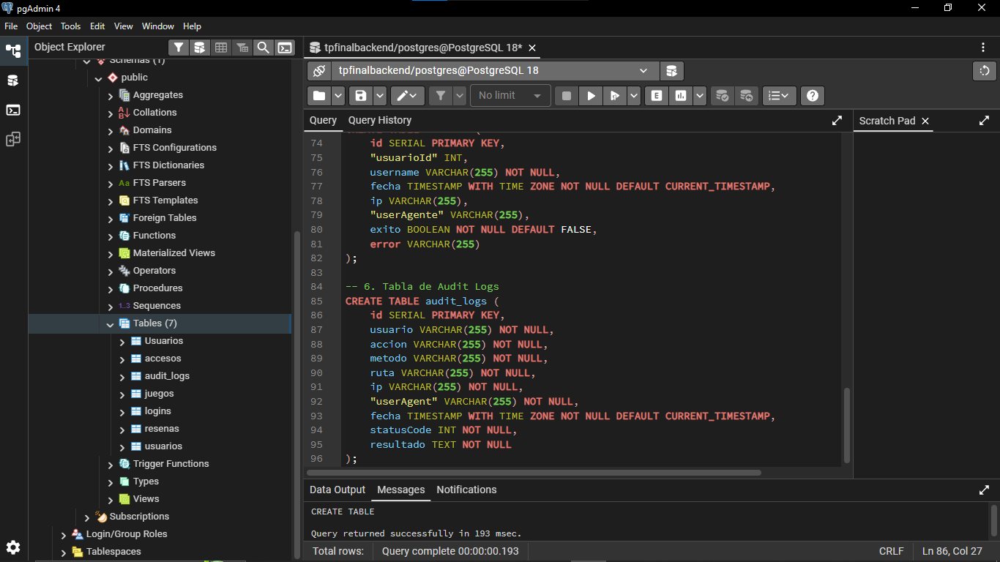

# Historia de Usuario 06 (HU-06): Inicialización de Esquemas e Inyección Masiva de 6M de Registros

## 1. Descripción General

- **ID:** HU-06
- **Título:** Inyección de dataset de 6.000.000 de registros y estructuración relacional.
- **Sprint:** Sprint 2 (Fase 2).
- **Objetivo:** Soportar y validar el comportamiento de la base de datos relacional (PostgreSQL) bajo una carga masiva de escala empresarial, asegurando la integridad referencial entre las entidades del sistema (juegos, usuarios, logins, accesos y reseñas), de acuerdo con los modelos de Sequelize.

---

## 2. Criterios de Aceptación

1. [x] Creación del script DDL estructurado en `db-scripts/init/01_schema_init.sql`.
2. [x] Definición de claves primarias, tipos de datos y restricciones de clave foránea (`FOREIGN KEY`) para las entidades del sistema.
3. [x] Inyección automatizada de 6.000.000 de reseñas y datos complementarios mediante `generate_series`.
4. [x] Integración de los scripts SQL con el mecanismo de inicialización automática de PostgreSQL en Docker.
5. [x] Verificación de las cantidades de registros insertados y documentación de los tiempos de inicialización.

---

## 3. Evidencia Técnica e Implementación

### A. Inicialización de Esquemas

Se implementó el script DDL `db-scripts/init/01_schema_init.sql`, encargado de crear las tablas relacionales del sistema:

- `logins`
- `Usuarios`
- `juegos`
- `resenas`
- `accesos`
- `audit_logs`

Se definieron las claves primarias y las relaciones mediante claves foráneas, manteniendo la integridad referencial entre las entidades.

### B. Inyección Masiva de Datos

Mediante el script `db-scripts/seeders/02_massive_seed_6M.sql` se generó un conjunto de datos de prueba utilizando `generate_series()` e inserciones basadas en operaciones `INSERT INTO ... SELECT`.

La carga contempla las siguientes cantidades:

| Tabla | Registros insertados |
|---|---:|
| juegos | 5.000 |
| logins | 10.000 |
| Usuarios | 10.000 |
| resenas | 6.000.000 |
| accesos | 10.000 |
| audit_logs | 10.000 |
| **Total** | **6.045.000** |

Para mejorar el rendimiento de la carga se utilizó `synchronous_commit = OFF` durante la ejecución del script y se realizaron operaciones `ANALYZE` al finalizar.

### C. Integración con Docker

Los scripts se integraron al proceso de inicialización automática del contenedor PostgreSQL mediante el directorio `/docker-entrypoint-initdb.d/`.

De esta manera, cuando PostgreSQL inicializa un volumen de datos vacío, ejecuta automáticamente los scripts en orden:

1. `01_schema_init.sql`: creación de la estructura de la base de datos.
2. `02_massive_seed_6M.sql`: inserción de los datos de prueba.

Esto permite reproducir la inicialización de la base de datos sin tener que ejecutar manualmente los scripts desde pgAdmin.

### D. Métricas y Verificación

Se realizaron dos mediciones diferenciadas:

- **Ejecución independiente del script SQL:** 2 minutos y 37 segundos, correspondiente a la medición anterior realizada fuera del proceso de inicialización de Docker.
- **Inicialización mediante Docker Compose:** 623 segundos (10 minutos y 23 segundos), correspondientes al tiempo observado durante el arranque completo de los servicios con la inicialización de PostgreSQL.

La segunda medición contempla el proceso de inicialización de la base de datos y el arranque de los servicios dependientes, por lo que no representa exclusivamente el tiempo de ejecución del script SQL.

La carga se verificó mediante consultas `COUNT(*)` ejecutadas directamente sobre PostgreSQL, confirmando los 6.000.000 de registros de reseñas y las cantidades correspondientes al resto de las tablas.

---

## 4. Conclusión

La implementación permitió automatizar la creación de la estructura relacional y la carga de un dataset de 6.045.000 registros, incluyendo 6 millones de reseñas, manteniendo las restricciones de integridad referencial.

La integración de los scripts con Docker permite reproducir el proceso de inicialización de PostgreSQL de manera automática y consistente. Además, la verificación de los registros confirmó que la carga se completó correctamente.

Con esta implementación, la base de datos queda preparada para realizar pruebas de rendimiento y optimización de consultas correspondientes a la HU-08.