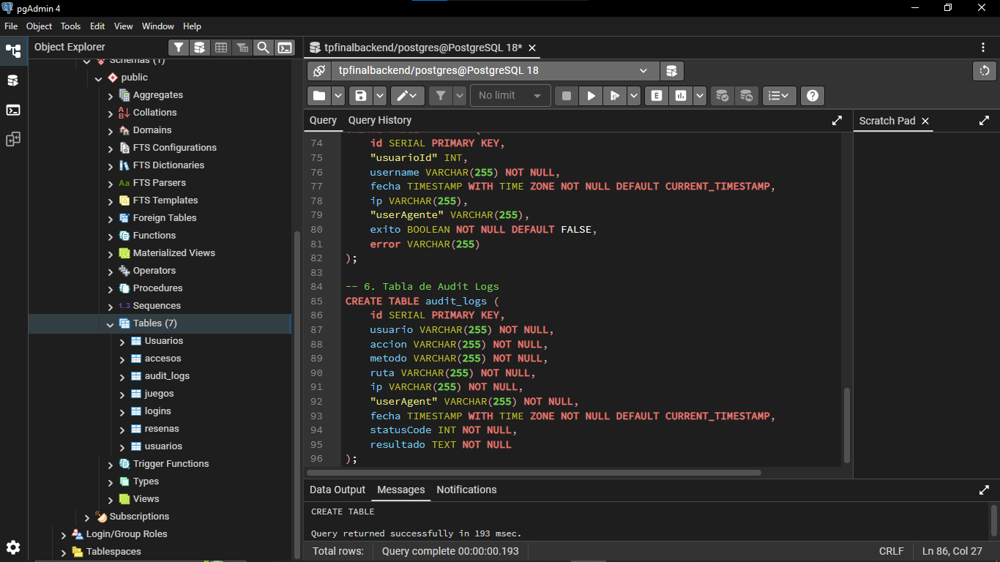
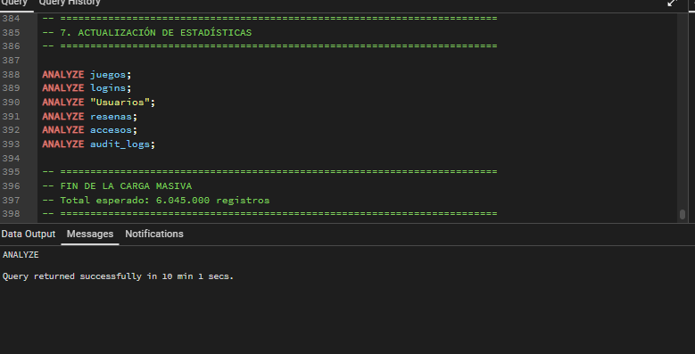

# Historia de Usuario 06 (HU-06): Estructuración Relacional e Inyección Masiva de 6M de Registros

## 1. Descripción General

- **ID:** HU-06
- **Título:** Inyección de dataset de más de 6.000.000 de registros y estructuración relacional.
- **Sprint:** Sprint 2 (Fase 2).
- **Objetivo:** Soportar y validar el comportamiento de la base de datos relacional (PostgreSQL) bajo una carga masiva de escala empresarial, asegurando la integridad referencial entre las entidades del sistema (juegos, logins, usuarios, accesos y reseñas), de acuerdo con los modelos de Sequelize.

---

## 2. Criterios de Aceptación

1. [x] Creación del script DDL estructurado en `db-scripts/init/01_schema_init.sql`.
2. [x] Definición de claves primarias, tipos de datos y restricciones de claves foráneas (`FOREIGN KEY`), respetando la estructura de los modelos del backend.
3. [x] Inyección automatizada y eficiente de un volumen superior a los 6.000.000 de registros mediante `generate_series()`.
4. [x] Registro y documentación de métricas de rendimiento y evidencias de la ejecución de los scripts SQL.

---

## 3. Evidencia Técnica e Implementación

### A. Creación del Esquema Relacional

Se implementó el script DDL `db-scripts/init/01_schema_init.sql`, encargado de definir la estructura de las tablas relacionales del sistema:

- `logins`
- `"Usuarios"`
- `juegos`
- `resenas`
- `accesos`
- `audit_logs`

Se definieron las claves primarias, los tipos de datos, las restricciones y las relaciones mediante claves foráneas, manteniendo la integridad referencial entre las entidades.

La estructura respeta los nombres de tablas y columnas utilizados por los modelos de Sequelize.

### B. Inyección Masiva de Datos

Mediante el script `db-scripts/seeders/02_massive_seed_6M.sql` se generó un conjunto de datos de prueba utilizando `generate_series()` e instrucciones `INSERT INTO ... SELECT`.

La carga contempla las siguientes cantidades:

| Tabla | Registros insertados |
|---|---:|
| juegos | 5.000 |
| logins | 10.000 |
| Usuarios | 10.000 |
| resenas | 6.000.000 |
| accesos | 10.000 |
| audit_logs | 10.000 |
| **Total** | **6.045.000** |

Para optimizar el proceso se utilizó `synchronous_commit = OFF` durante la carga. Además, se ejecutaron operaciones `ANALYZE` al finalizar para actualizar las estadísticas utilizadas por el optimizador de consultas de PostgreSQL.

#### Generación aleatoria de los datos

El seeder genera los datos con valores aleatorios (`random()`) en lugar de patrones cíclicos, con el objetivo de obtener un conjunto de datos más variado:

- **Juegos:** franquicia, subtítulo, desarrolladora, plataformas, géneros, fecha de lanzamiento y calificación se eligen de forma aleatoria. La portada muestra el nombre del juego sobre un color de fondo aleatorio.
- **Logins:** nombre, apellido, fecha de creación y presencia de `googleId` se generan de forma aleatoria.
- **Reseñas:** el juego, el usuario, el texto, los likes y la fecha se generan de forma aleatoria. Los likes siguen una distribución sesgada.
- **Accesos y auditoría:** usuario, IP, user agent y fecha son aleatorios; el estado de éxito o error y el código HTTP se calculan de forma coherente con el resultado registrado.

Las cantidades por tabla no cambian. Los identificadores generados se mantienen dentro de los rangos válidos (1 a 5.000 para juegos y 1 a 10.000 para usuarios), por lo que se conserva la integridad referencial.

#### Generación aleatoria y coherente de los datos

El seeder fue ajustado (`fix/hu-06-aleatorizar-seed`) para que los datos sintéticos presenten mayor variedad en lugar de patrones cíclicos:

- **Juegos:** franquicia, subtítulo, desarrolladora, plataformas, géneros, fecha de lanzamiento y calificación se eligen de forma aleatoria. La portada muestra el nombre del juego sobre un color de fondo aleatorio.
- **Logins:** nombre, apellido, fecha de creación y presencia de `googleId` se generan de forma aleatoria.
- **Reseñas:** el juego, el usuario, el texto, los likes y la fecha se generan con `random()`. Los likes siguen una distribución sesgada (pocas reseñas con muchos likes).
- **Accesos y auditoría:** usuario, IP, user agent, resultado y fecha son aleatorios; el estado de éxito/error y el código HTTP se calculan de forma coherente con el resultado registrado.

La cantidad de registros por tabla no cambió. Los identificadores aleatorios se mantienen dentro de los rangos válidos (1–5.000 para juegos y 1–10.000 para usuarios), por lo que la integridad referencial se conserva.

### C. Métricas de Rendimiento

Se registró el tiempo de ejecución independiente de la carga masiva:

- **Tiempo total de ejecución:** 10 minutos y 1 segundo (aproximadamente 601 segundos).
- **Estrategia utilizada:** generación de datos mediante funciones orientadas a conjuntos e inserciones `INSERT INTO ... SELECT` sobre `generate_series()`.
- **Optimización aplicada:** desactivación temporal de `synchronous_commit` durante la carga.

Este tiempo corresponde a la versión actual del seeder, que genera valores aleatorios y es mayor al de la primera versión (2 minutos y 37 segundos), basada en operaciones determinísticas. El tiempo puede variar según el hardware, la carga del equipo y los índices existentes en la base al momento de la medición.
---

## 4. Conclusión

La implementación permitió definir la estructura relacional de la base de datos y completar satisfactoriamente la carga masiva de 6.045.000 registros, respetando las relaciones y restricciones establecidas.

La utilización de operaciones orientadas a conjuntos y ajustes de rendimiento permitió realizar la carga de manera eficiente, registrando un tiempo de ejecución de 10 minutos y 1 segundo con datos generados de forma aleatoria.

Con esta implementación, la base de datos quedó preparada para las pruebas de rendimiento y optimización de consultas correspondientes a la HU-08.