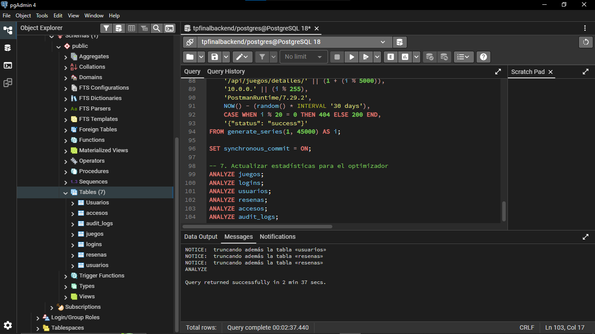

# Historia de Usuario 06 (HU-06): Inicialización de Esquemas e Inyección Masiva de 6M de Registros

## 1. Descripción General
* **ID:** HU-06
* **Título:** Inyección de dataset de 6.000.000 de registros y estructuración relacional.
* **Sprint:** Sprint 2 (Fase 2)
* **Objetivo:** Soportar y validar el comportamiento de la base de datos relacional (PostgreSQL) bajo una carga masiva de escala empresarial, asegurando la integridad referencial entre las entidades del sistema (juegos, logins, accesos y reseñas) basadas en los modelos de Sequelize.

---

## 2. Criterios de Aceptación
1. [x] Creación del script DDL estructurado en `db-scripts/init/01_schema_init.sql`.
2. [x] Réplica exacta de las claves primarias, tipos de datos y restricciones de clave foránea (`FOREIGN KEY`) definidas en el backend.
3. [x] Inyección automatizada y eficiente de un volumen superior a los 6.000.000 de registros mediante `generate_series`.
4. [x] Registro y documentación de métricas de rendimiento (tiempo de ejecución y evidencia visual).

---

## 3. Evidencia Técnica e Implementación

### A. Inicialización de Esquemas
El script DDL implementó la destrucción limpia y la creación ordenada de las tablas relacionales (`logins`, `usuarios`, `juegos`, `resenas`, `accesos` y `audit_logs`).

> 

### B. Inyección Masiva (Seeders)
Mediante el script optimizado en `db-scripts/seeders/02_massive_seed_6M.sql`, se poblaron datos realistas distribuidos entre el catálogo de videojuegos, perfiles de usuario y el núcleo masivo de reseñas.

* **Tiempo total de ejecución:** 2 minutos y 37 segundos.
* **Estrategia utilizada:** Inserción por bloques con funciones orientadas a conjuntos y desactivación temporal de `synchronous_commit`.

> 

---

## 4. Conclusión
La estructuración de scripts SQL optimizados permitió completar con éxito la carga masiva de datos respetando las reglas de negocio del backend, dejando la infraestructura lista para las pruebas de optimización de consultas de la HU-08.