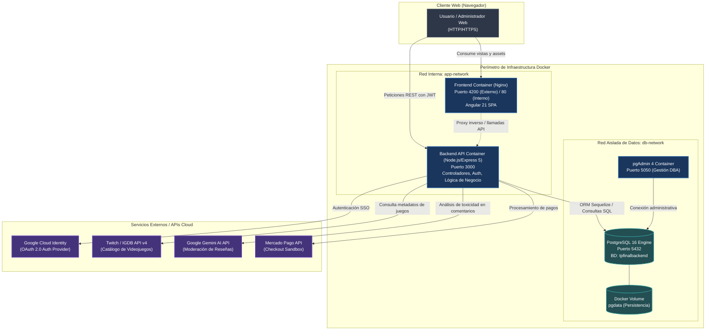

# Informe General y Diagnóstico Técnico Inicial
**Trabajo Práctico Integrador Final 2026**  
**Materia:** Herramientas Informáticas Avanzadas  
**Equipo:** Grupo 08  
**Rol:** Arquitectura de Software y Scrum Team  
**Fecha:** Noviembre 2026  

---

## 1. Cumplimiento de Criterios de Aceptación (Historia de Usuario 1)

Este documento da cumplimiento formal a la historia de usuario **HU-01**: *"Como equipo, quiero documentar la app y su stack tecnológico para iniciar el proyecto"*, validando los siguientes criterios de aceptación:

- [x] **Aplicación web seleccionada y diagnosticada:** Identificación funcional completa del sistema seleccionado (*Red Social Gamer y Catálogo de Videojuegos*).
- [x] **Inventario tecnológico documentado:** Detalle exhaustivo de Frontend (Angular 21), Backend (Node.js/Express 5), Base de Datos (PostgreSQL 16) y dependencias auxiliares.
- [x] **Estructura de monorepo definida:** Organización de carpetas para el desarrollo integral de las 6 fases del trabajo integrador.
- [x] **Diagrama de arquitectura inicial:** Diagrama en código Mermaid que modela los flujos e interacciones entre capas y servicios externos.

---

## 2. Descripción de la Aplicación Seleccionada

La aplicación seleccionada para el proyecto integrador es una **Plataforma Web de Red Social Gamer, Catálogo y Reseñas de Videojuegos con Moderación Asistida por Inteligencia Artificial**.

### 2.1 Propósito y Valor del Negocio
El sistema provee un entorno colaborativo y centralizado donde los entusiastas de los videojuegos pueden descubrir títulos, consultar información técnica y calificaciones en tiempo real, interactuar con otros miembros de la comunidad mediante reseñas, gestionar listas de favoritos y acceder a un módulo de suscripción/pagos. Paralelamente, proporciona a los administradores un panel de control con métricas operativas, auditoría continua de eventos y moderación automática de contenido tóxico empleando IA.

### 2.2 Módulos Funcionales Principales

1. **Gestión de Identidad, Autenticación y Autorización:**
   - Registro e inicio de sesión local mediante contraseñas cifradas unidireccionalmente con `bcrypt`.
   - Autenticación federada Single Sign-On (SSO) mediante Google OAuth 2.0 (Passport.js).
   - Generación de sesiones y tokens seguros `JWT` para la autorización de peticiones en endpoints protegidos.
   - Control de acceso basado en roles (RBAC: `Usuario`, `Administrador`).

2. **Catálogo de Videojuegos y Sincronización Externa:**
   - Búsqueda interactiva con autocompletado y filtros por género, plataforma y calificación.
   - Integración con la API externa de **IGDB (Twitch)** para la ingesta de metadatos, carátulas y descripciones.
   - Mecanismo de persistencia y caché local en base de datos PostgreSQL para reducir la latencia de respuesta y optimizar el consumo de la cuota de la API externa.
   - Traducción automática dinámica de sinopsis y descripciones al español mediante servicios de traducción.

3. **Comunidad, Reseñas y Moderación Automática con Inteligencia Artificial:**
   - Publicación de calificaciones numéricas y reseñas detalladas por título.
   - Pipeline de **moderación preventiva asistida por Google Gemini API (`@google/generative-ai`)**: el texto ingresado por el usuario es analizado en tiempo real para clasificar toxicidad, lenguaje ofensivo, incitación al odio o spam. Si la IA detecta infracciones a las políticas comunitarias, la reseña queda retenida o es rechazada automáticamente.

4. **Transacciones y Pasarela de Pagos:**
   - Integración con el checkout de **Mercado Pago** (entorno Sandbox) para la adquisición de membresías premium y contenidos digitales.

5. **Panel Administrativo (Dashboard) y Reportería:**
   - Métricas en tiempo real: usuarios activos, volumen de reseñas, accesos fallidos y juegos en tendencia.
   - Visualización analítica interactiva implementada con **Chart.js** y **ng2-charts**.
   - Generación y exportación de reportes ejecutivos en formato **Excel (`xlsx`)** y documentos oficiales en **PDF (`jsPDF` + `jspdf-autotable`)**.

6. **Auditoría, Seguridad y Trazabilidad:**
   - Registro cronológico inmutable de accesos, inicios de sesión y modificaciones críticas (`Audit`, `Acceso`, `Login`).
   - Sanitización de entradas contra Cross-Site Scripting (`xss`) y prevención de inyecciones SQL mediante consultas parametrizadas por ORM.
   - Documentación viva de endpoints REST mediante contrato OpenAPI / **Swagger UI** accesible en `/api-docs`.

---

## 3. Inventario Tecnológico Exhaustivo

### 3.1 Capa de Frontend (Cliente Web)
- **Framework:** Angular 21 (arquitectura moderna orientada 100% a Componentes Standalone, sin `NgModule`).
- **Lenguaje:** TypeScript 5.9.
- **Enrutamiento y Estado:** Angular Router con Guards de autenticación y flujos reactivos basados en **RxJS 7.8** (manejo de debouncing en búsquedas, interceptores HTTP para tokens JWT).
- **Diseño de Interfaz de Usuario:** Bootstrap 5.3 + Bootstrap Icons + animaciones CSS responsivas (diseño temático Dark Gamer).
- **Alertas y Notificaciones:** SweetAlert2.
- **Visualización y Gráficos:** Chart.js 4.5 integrado con `ng2-charts` 10.0.
- **Exportación de Datos:** SheetJS (`xlsx` 0.18.5) para planillas de cálculo y `jspdf` 4.2 con `jspdf-autotable` 5.0 para generación de reportes PDF vectoriales.
- **Testing Unitario:** Vitest 4.0 y jsdom.
- **Servidor de Producción Contenerizado:** Servidor HTTP inverso **Nginx Alpine** para servir estáticos precompilados optimizados.

### 3.2 Capa de Backend (Servidor de Aplicación y API REST)
- **Entorno de Ejecución:** Node.js (versiones 20 LTS / 24).
- **Framework Web:** Express 5.x (arquitectura MVC con enrutamiento modular y middlewares).
- **Capa de Abstracción de Datos (ORM):** Sequelize 6.37.
- **Autenticación y Sesiones:** 
  - `jsonwebtoken` (JWT) para stateless auth en endpoints de la API.
  - `passport` y `passport-google-oauth20` para delegación de identidad federada.
  - `express-session` para la orquestación temporal de flujos OAuth.
- **Criptografía y Sanitización:** `bcrypt` / `bcryptjs` (hashing de claves con salt cost factor 10) y `xss` para higienización de payloads HTML/JSON.
- **Servicios e Integraciones Externas:**
  - `@google/generative-ai` (Google Gemini SDK) para procesamiento de lenguaje natural y moderación de contenido.
  - `axios` 1.18 para llamadas asíncronas a la API IGDB v4 / Twitch.
  - `google-translate-api-x` para localización de sinopsis.
- **Documentación de API:** `swagger-ui-express` 5.0 y `swagger-autogen` 2.23.
- **Configuración:** `dotenv` para aislamiento estricto de credenciales y variables de entorno.

### 3.3 Capa de Base de Datos y Persistencia
- **Motor Relacional:** PostgreSQL 16 (dialecto Postgres, transacciones ACID nativas).
- **Conectores:** Driver nativo `pg` 8.22 y `pg-hstore` 2.3.
- **Base de Datos Operativa:** `tpfinalbackend`.
- **Modelos de Datos Principales:**
  - `Usuario`: Gestión de perfiles, credenciales hasheadas, roles y estados.
  - `Login`: Trazabilidad de accesos (dirección IP, timestamp, éxito o fallo).
  - `Acceso`: Métricas de navegación interna por vista/recurso.
  - `Juego`: Metadatos cacheados de videojuegos (ID IGDB, nombre, sinopsis, género, calificación).
  - `Resena`: Comentarios comunitarios, puntaje y estado de moderación IA (`aprobado`, `rechazado`, `pendiente`).
  - `Audit`: Bitácora inmutable de eventos sensibles del sistema.
- **Gestión Visual:** Contenedor oficial de **pgAdmin 4**.

### 3.4 Orquestación y Contenerización
- **Motor de Contenedores:** Docker Engine 26+.
- **Orquestación Multi-contenedor:** Docker Compose v2.
- **Redes Virtuales Internas:** Segmentación de redes de aplicación (`app-network`) y datos (`db-network`).
- **Almacenamiento Persistente:** Named Volumes de Docker para garantizar la persistencia de datos del motor PostgreSQL y la configuración de pgAdmin.

---

## 4. Estructura Propuesta del Monorepo

Para estructurar ordenadamente el proyecto a lo largo de las 6 fases del trabajo integrador, se define la siguiente arquitectura de repositorio:

```text
proyecto-final-grupo-08/
├── .github/
│   └── workflows/
│       ├── ci-cd-pipeline.yml         # Pipeline automatizado de linting, tests, build y despliegue
│       └── security-scan.yml          # Escaneo de dependencias y vulnerabilidades
├── backend/
│   ├── config/
│   │   ├── database.js                # Conexión Sequelize con PostgreSQL
│   │   └── passport.js                # Estrategia de autenticación Google OAuth 2.0
│   ├── src/
│   │   ├── controllers/               # Controladores de negocio (Auth, Juegos, Reseñas, Dashboard)
│   │   ├── middlewares/               # Middlewares (JWT verify, roles, XSS sanitization, audit)
│   │   ├── models/                    # Modelos Sequelize (Usuario, Juego, Reseña, Audit, etc.)
│   │   ├── routes/                    # Declaración de rutas REST
│   │   └── services/                  # Servicios externos (IGDB API, Gemini AI SDK)
│   ├── .env.example                   # Plantilla de variables de entorno seguras (sin secretos)
│   ├── Dockerfile                     # Dockerfile optimizado para producción Node.js
│   ├── index.js                       # Punto de entrada de la API Express
│   ├── package.json                   # Dependencias de backend
│   └── swagger.js                     # Generador de especificación Swagger
├── frontend/
│   ├── src/
│   │   ├── app/
│   │   │   ├── components/            # Componentes standalone (Navbar, Catálogo, Login, Dashboard)
│   │   │   ├── guards/                # Guardas de ruta para protección de navegación
│   │   │   ├── interceptors/          # Interceptor HTTP para inyección de token JWT
│   │   │   ├── models/                # Interfaces y tipos TypeScript
│   │   │   └── services/              # Servicios Angular (AuthService, GameService, AdminService)
│   │   ├── assets/                    # Recursos estáticos e imágenes
│   │   └── index.html                 # Página base SPA
│   ├── Dockerfile                     # Construcción multi-stage (Node.js build -> Nginx Alpine)
│   ├── nginx.conf                     # Configuración de Nginx para SPA (fallback index.html)
│   └── package.json                   # Dependencias de frontend (Angular 21)
├── db-scripts/
│   ├── init/
│   │   └── 01_schema_init.sql         # DDL de inicialización de esquemas y tablas
│   ├── seeders/
│   │   └── 02_massive_seed_6M.sql     # Script SQL / procedimiento para generar 6M de registros
│   ├── optimizations/
│   │   ├── explain_queries_before.sql # Planes de ejecución iniciales con EXPLAIN ANALYZE
│   │   ├── create_indexes.sql         # Sentencias DDL de índices B-tree, compuestos y funcionales
│   │   └── explain_queries_after.sql  # Planes de ejecución posteriores y comparativa de costos
│   └── backups/
│       ├── backup_db.sh               # Script de respaldo lógico automatizado con pg_dump
│       └── restore_db.sh              # Script de restauración verificada con pg_restore
├── replication/
│   ├── primary/
│   │   ├── postgresql.conf            # Configuración WAL, listen_addresses, max_wal_senders
│   │   └── pg_hba.conf                # Reglas de autenticación para usuario de replicación
│   ├── standby/
│   │   └── setup_replica.sh           # Script de provisionamiento de réplica con pg_basebackup
│   └── failover/
│       └── promote_standby.sh         # Procedimiento de promoción ante contingencia
├── monitoring/
│   ├── prometheus/
│   │   ├── prometheus.yml             # Scrape configs (node_exporter, cadvisor, postgres_exporter)
│   │   └── alerts.yml                 # Reglas de umbrales críticos (CPU > 85%, DB down, etc.)
│   └── grafana/
│       ├── provisioning/              # Data sources y dashboards automáticos
│       └── dashboards/
│           └── general_health.json    # Tablero unificado con métricas de sistema y base de datos
├── n8n/
│   └── workflows/
│       ├── workflow_infra_alerts.json # Flujo 1: Prometheus Alertmanager -> GLPI Ticket
│       ├── workflow_backup_check.json # Flujo 2: Notificación y verificación de respaldos
│       └── workflow_ai_report.json    # Flujo 3: Consolidado de métricas con informe asistido por IA
├── glpi/
│   └── compose-glpi.yml               # Stack dockerizado para GLPI (Mesa de ayuda)
├── docs/
│   ├── sprint_reviews/                # Minutas de fin de sprint y evidencias Scrum
│   ├── glpi_tickets/                  # Evidencia y cierre de los 10 tickets de incidentes
│   └── documentacion_tecnica_16_puntos.md # Borrador hacia el documento técnico unificado final
├── docker-compose.yml                 # Orquestación de desarrollo local
├── docker-compose.prod.yml            # Orquestación de producción
├── .gitignore                         # Reglas de exclusión de git (exclusión estricta de .env)
└── README.md                          # Guía de inicialización rápida del proyecto
```

---

## 5. Diagrama de Arquitectura Inicial

El siguiente diagrama modela la topología de la aplicación, los límites de red de contenedores, la interacción entre servicios internos y los enlaces con APIs externas:



---

## 6. Diagnóstico Técnico y Plan de Mejoras

### 6.1 Diagnóstico de la Situación Inicial
1. **Acoplamiento al entorno local:** El backend inicial poseía configuraciones apuntadas a `localhost` con variables dispersas, requiriendo estandarización estricta mediante variables de entorno inyectadas vía Docker Compose.
2. **Volumen de datos reducido:** La base de datos operaba con datasets pequeños en memoria/disco; para simular entornos de producción de alta demanda es mandatario inyectar el lote de **6.000.000 de registros**.
3. **Punto único de fallo (SPOF):** La base de datos corre en una única instancia local sin tolerancia a fallos ni replicación activa.
4. **Ausencia de pipeline de entrega:** El despliegue requería intervención manual en terminales locales (`npm run dev`, `ng serve`).
5. **Observabilidad nula:** Falta de telemetría, métricas de consumo de recursos y monitoreo de salud en tiempo real.

### 6.2 Plan de Acción y Mejoras Técnicas (Roadmap Integrador)
1. **Contenerización y Persistencia (Sprint 2):** Dockerizar PostgreSQL asegurando persistencia de datos mediante volúmenes con nombre y aislamiento por redes internas.
2. **Carga Masiva de Datos (Sprint 2):** Diseñar e implementar un procedimiento SQL eficiente (con `generate_series` y carga en lote transaccional) para inyectar 6M de registros manteniendo la integridad referencial.
3. **Optimización con EXPLAIN ANALYZE (Sprint 3):** Identificar 8 consultas críticas en las tablas `Juegos`, `Resenas`, `Accesos` y `Audits`, diseñando índices estratégicos B-tree y compuestos para evitar Sequential Scans masivos.
4. **Alta Disponibilidad y Replicación (Sprint 3):** Configurar un clúster PostgreSQL Principal-Réplica mediante Streaming Replication con WAL streaming y documentar el protocolo de failover.
5. **Contenerización Completa y CI/CD (Sprint 4):** Crear Dockerfiles optimizados multi-stage y pipelines en GitHub Actions para validaciones y despliegues automáticos.
6. **Perímetro Seguro y Observabilidad (Sprint 5):** Exponer la plataforma de manera segura con Cloudflare Tunnel (HTTPS) e integrar Prometheus y Grafana con alertas por umbrales.
7. **Automatización y Ciberseguridad (Sprint 6):** Conectar n8n con GLPI y Prometheus, elaborar la matriz de amenazas de ciberseguridad y consolidar el Documento Técnico Unificado de 16 puntos.
